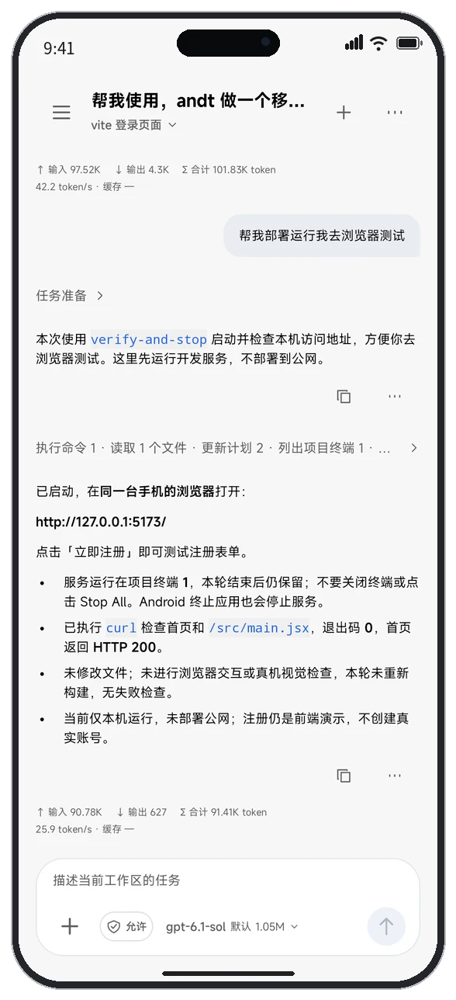
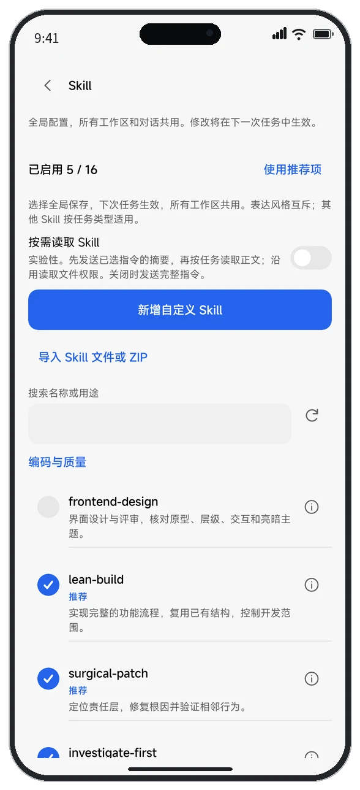
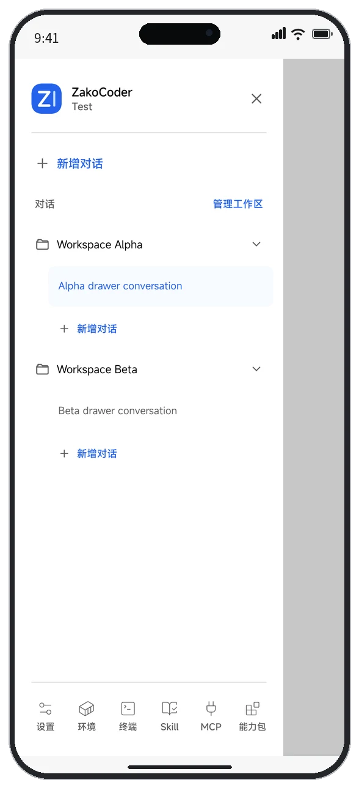

  

<h1 align="center">ZakoCoder</h1>

<strong>在 Android 上，与 AI 一起完成开发</strong>

AI 助手 · 工作区 · 代码编辑 · Linux 终端 · 变更审阅

  
  
  
  

  <a href="https://github.com/AYssu/ZakoCoder/releases/latest">下载安装</a> ·
  <a href="#界面预览">界面预览</a> ·
  <a href="#开始使用">开始使用</a> ·
  <a href="https://github.com/AYssu/ZakoCoder/issues/new/choose">反馈问题</a>

ZakoCoder 是一款开源的 Android 原生 AI 编码工作台。你可以让助手阅读和修改代码，在编辑器中检查结果，用手机上的 Linux 终端运行项目，再审阅变更与验证记录。

工作区组织源码和对话；模型服务由你选择，开发工具按需安装。适合网页、脚本、命令行程序，以及满足工具链要求的 Android、Flutter 工程。也可以单独使用编辑器和终端。

> 本页介绍主分支当前能力，已发布安装包可能稍有不同。版本变化与已知问题以对应发布说明为准。

## 下载安装

前往 [Releases](https://github.com/AYssu/ZakoCoder/releases) 下载，日常使用选择正式版；标有 **Pre-release** 的版本用于提前体验和反馈。按设备架构和是否需要内置环境选择安装包：

| 版本 | 适合谁 | 包含什么 |
| --- | --- | --- |
| **Lite 轻量版** | 希望按需下载、减少安装包体积 | Ubuntu 可在线安装或本地导入；代理内核按需安装独立插件。 |
| **Full 完整版** | 希望减少首次环境下载 | 内置基础 Ubuntu 和代理内核，确认后在本机初始化，无需另装内核插件。 |

- **ARM64 / arm64-v8a**：大多数 Android 手机。
- **x86_64**：对应架构的设备与常见电脑 Android 模拟器。
- 下载同一发布页的 `SHA256SUMS.txt`，用于校验安装包完整性。附件以该发布实际提供的内容为准。

Full 仍需按项目安装 Node.js、Python、Java 等开发工具，并自行配置模型服务。Lite 与 Full 共用应用数据，切换时使用同签名且可覆盖升级的安装包；不要为切换版本直接卸载，以免丢失私有数据。签名与升级说明见[安装和测试说明](docs/BETA_TESTING.md)。

需要测试主分支时，可在 [Debug 构建](https://github.com/AYssu/ZakoCoder/actions/workflows/build-apk.yml) 的成功运行中单独下载所需 APK；Artifacts 下载需要登录 GitHub。

## 界面预览

以下为 Android 应用的实际开发演示与测试截图，使用装饰性手机外框展示；具体布局以安装版本为准。

<table>
  <tr>
    <td align="center"></td>
    <td align="center"></td>
    <td align="center"></td>
  </tr>
</table>

## 你可以做什么

| 场景 | 功能 |
| --- | --- |
| **让 AI 协助开发** | 引用文件、选中代码、图片或报错，查看流式回答、工具执行过程和审批；执行中补充要求，保留本地对话记录。 |
| **管理源码与对话** | 创建、导入或克隆工程，按工作区分组对话；Work 使用应用内副本，本地模式直接修改绑定目录。 |
| **编辑与运行** | 原生代码编辑器、多文件切换、草稿恢复与 Markdown 预览；最多四个终端会话，运行服务后在手机浏览器预览。 |
| **审阅与恢复** | 查看修改文件、增删行数与代码差异；使用任务检查点检查和恢复文件，核对实际构建与测试结果。 |
| **同步 Git** | 克隆公开或私有 HTTPS 仓库，查看状态、暂存、提交、获取、拉取和推送，并处理分支与冲突。 |
| **扩展助手** | 全局管理内置或自定义 Skill，导入 Markdown / ZIP，连接 HTTP / SSE MCP；按需开启屏幕操作和 SSH 远程开发。 |
| **了解用量** | 查看每轮输入、输出、缓存和耗时，以及按时间、工作区和模型汇总的本机用量。 |

支持 Chat Completions、Responses、Anthropic Messages、Gemini 原生协议，兼容 HTTP / HTTPS 服务地址；模型能力、参数和费用取决于你配置的服务。详见[模型配置](docs/MODEL_PROTOCOLS.md)、[请求与用量](docs/AI_USAGE.md)。

## 开始使用

1. **完成初始化**：首次打开时选择开发用途，配置环境、模型、Skill 和所需权限；可跳过部分步骤，之后从「设置 → 初始化配置」重新进入。
2. **添加工作区**：选择 Work 应用内副本或本地目录，也可以导入源码、克隆仓库。同一工作区的对话共用源码；导入副本不会同步修改原目录。
3. **准备所需工具**：从环境页安装或初始化 Ubuntu，再选择项目需要的工具包。安装工具不会自动启用语言服务。
4. **开始对话或编辑**：配置模型并测试连接，新建对话交代任务；也可以直接打开文件修改，手动保存源码。
5. **运行并检查**：执行构建、测试或启动命令，查看日志、变更和实际结果，再决定是否保留修改或提交 Git。

Skill、MCP 和屏幕能力是全局配置，不必先创建工作区；SSH 连接按工作区配置。系统权限可在「设置 → 权限管理」集中调整。

## 支持范围与使用须知

- **系统与架构**：提供 ARM64 和 x86_64 安装包。Android 11–17 已有基础兼容性记录，ARM64 真机主要覆盖 Android 13；最低安装要求为 Android 8.0，但不代表所有系统、厂商和开发工具均已验证。查看[实际兼容性记录](docs/ANDROID_COMPATIBILITY_RESULTS.md)。
- **开发环境**：Ubuntu 24.04 用户空间，工具按需安装。Android SDK / NDK、Flutter 和 Kotlin 语言服务存在架构限制；x86_64 安装包不意味着这些工具链全部可用。详见[运行环境](docs/RUNTIME.md)、[Flutter 开发](docs/FLUTTER.md)。
- **代码编辑**：UTF-8，单文件最多 1 MiB、最多八个缓冲区。Python、JS / TS、Java、Kotlin、C / C++、Go、Rust、Dart 语言服务为可选实验功能，默认关闭。详见[编辑器](docs/EDITOR.md)、[语言服务](docs/LSP.md)。
- **数据保存**：对话、草稿、配置和应用内工作区保存在本机；卸载或清除数据会删除私有数据。绑定目录中的源码仍在原位置，源码导出不是完整数据备份。
- **模型与权限**：AI 读取的项目内容和附件会发送到所选服务；密钥在本机加密保存。执行工具前请核对权限与审批，HTTP 明文连接不加密。
- **恢复与后台**：检查点只恢复覆盖范围内的文件，不能撤销依赖安装、网络或数据库等外部操作。PRoot 提供 Linux 兼容环境，不构成安全隔离；系统结束应用后，不保证终端任务继续运行。

更多说明：[产品范围](docs/PRODUCT.md) · [AI 工作流](docs/AI_WORKFLOW.md) · [Git](docs/GIT.md) · [屏幕操作](docs/SCREEN_TESTING.md) · [网络代理](docs/PROXY.md)

## 反馈与参与

遇到问题，请在 [Issues](https://github.com/AYssu/ZakoCoder/issues/new/choose) 提供应用版本、设备和 Android 版本、复现步骤，以及脱敏后的截图或日志。请勿提交 API 密钥、订阅令牌或私人源码。

欢迎贡献修复、翻译和功能建议。应用采用 Kotlin + Jetpack Compose 原生方案；源码构建、架构和协作流程分别见[开发文档](docs/DEVELOPMENT.md)、[架构说明](docs/ARCHITECTURE.md)和[贡献指南](CONTRIBUTING.md)。发布变化见[更新记录](CHANGELOG.md)。

## 开源致谢

感谢以下项目及其贡献者为原生编辑、终端和开发环境提供基础能力。

| 项目 | 在 ZakoCoder 中的用途 |
| --- | --- |
| [Sora Editor](https://github.com/Rosemoe/sora-editor) | 原生代码编辑器、TextMate 与实验性 LSP 接入。 |
| [Miuix](https://github.com/compose-miuix-ui/miuix) | 原生主题、交互控件和面板。 |
| [Termux](https://github.com/termux/termux-app) | 终端模拟与视图基础库。 |
| [PRoot](https://github.com/proot-me/PRoot) · [proot-distro](https://github.com/termux/proot-distro) · [Ubuntu](https://ubuntu.com/) | Linux 用户空间运行基础。 |
| [termux/proot](https://github.com/termux/proot) · [talloc](https://talloc.samba.org/) · [libandroid-shmem](https://github.com/termux/libandroid-shmem) | 仓库内保留源码，自行编译 PRoot 与 loader；见 [独立子项目](native-runtime/README.md)。 |
| [android-arm-build-tools](https://github.com/Commit451/android-arm-build-tools) · [android-ndk-custom](https://github.com/HomuHomu833/android-ndk-custom) | 可选手机 Android / NDK 构建工具链。 |
| [CommonMark Java](https://github.com/commonmark/commonmark-java) · [OkHttp](https://github.com/square/okhttp) | Markdown 解析和网络传输。 |
| [JSch](https://github.com/mwiede/jsch) | 原生 SSH 与 SFTP 传输。 |
| [JetBrains Mono](https://github.com/JetBrains/JetBrainsMono) | 随应用离线提供的等宽字体。 |

各组件的准确版本、来源、许可证、修改与分发方式以[第三方材料](THIRD_PARTY.md)为准；上表不替代原始许可证声明。

## 许可证

ZakoCoder 自有代码使用 [Apache License 2.0](LICENSE)。第三方组件保留各自许可证与版权声明。
