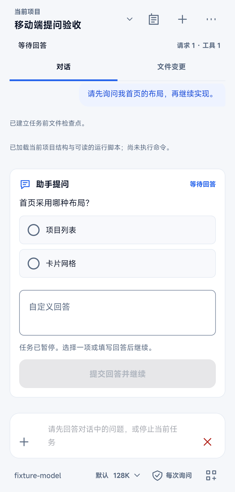
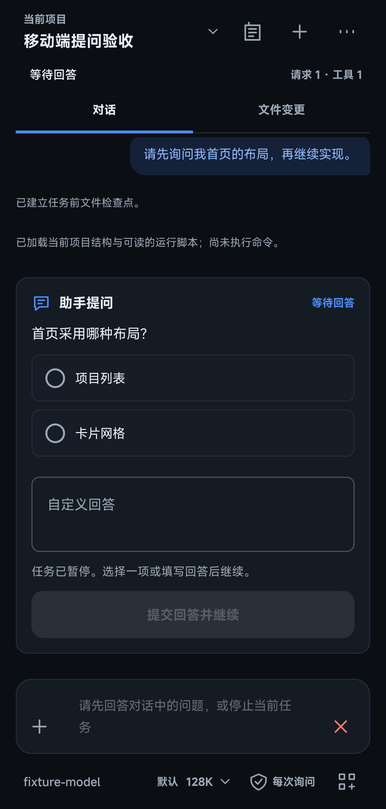
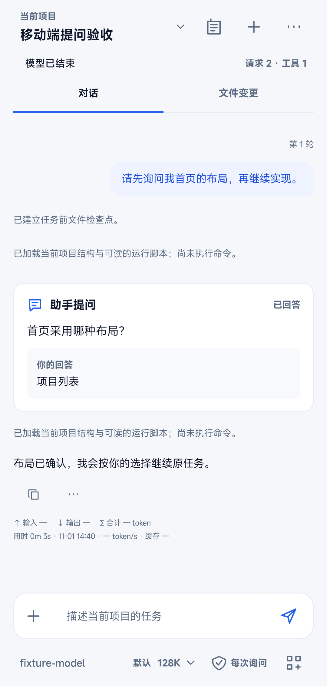
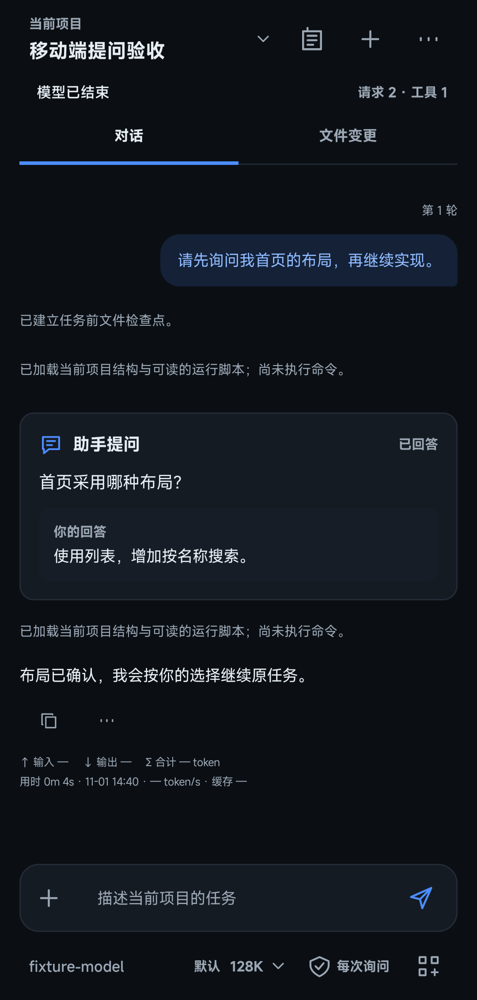
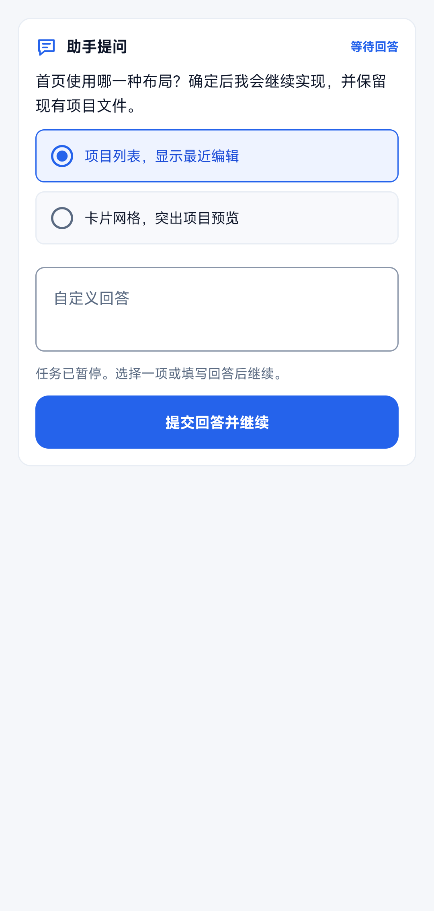
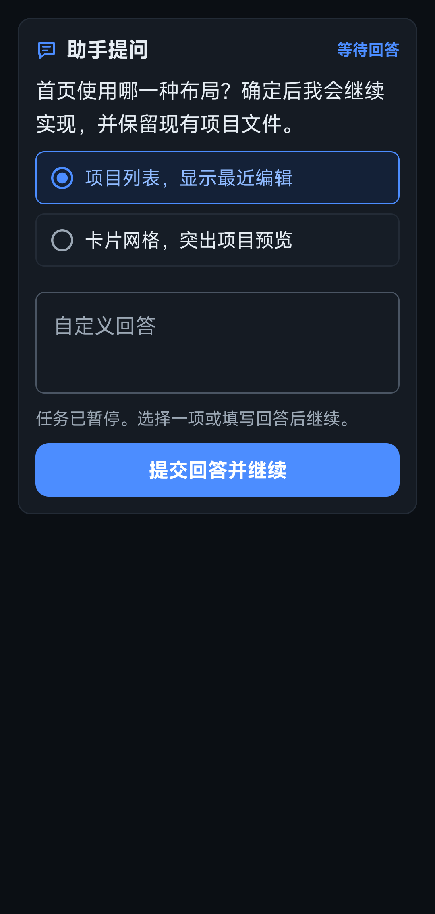
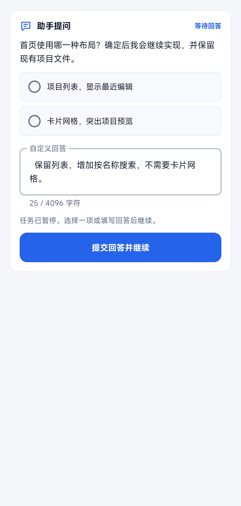
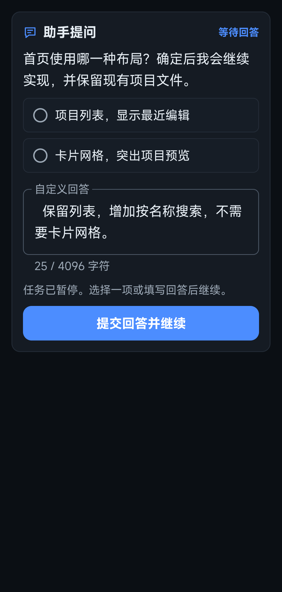
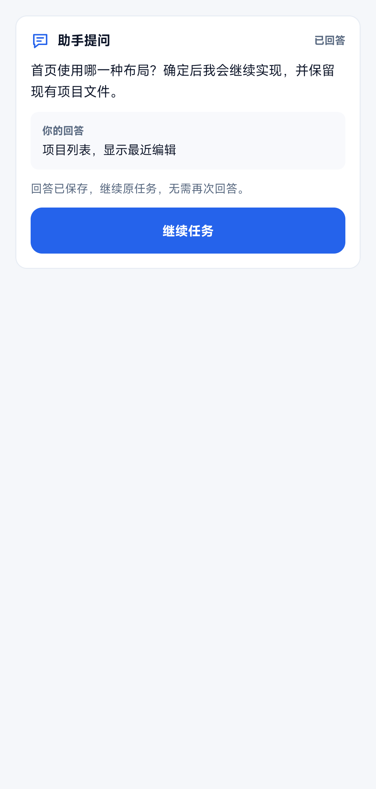
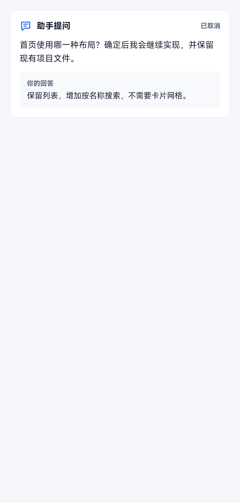

# 任务内提问验收

日期：2026-11-01。范围：结构化提问、用户回答、持久暂停及同轮续接，以及终端联网查询的提示约束。

## 当前行为

- `ask_user` 在原对话内显示一个问题、最多六个单选项和始终可用的自定义回答。提交回答继续原轮次、检查点与开始时间，回答不会提升任何工具权限。
- 等待期间不轮询模型。普通发送暂停，停止入口保留；问题、已提交回答和唯一待续接转录存入本机会话。
- 重启不自动发请求。未回答问题可继续填写；回答已保存、续接未完成时可直接继续，无需重新回答。续接使用原调用 ID 和工具结果，不重放已完成操作，重新加载当前权限及项目规则。
- 停止取消提问并保存记录，即使检查点封存失败或连续点击停止，也不能让旧问题在重启后复活。取消保留原任务恢复线索，不表示文件或外部副作用已回滚。
- 没有新增搜索供应商或专用网络工具。公开网页查询沿用审批后的 Ubuntu `curl`，限制时间和输出，网络或端点不可用就说明限制；本次未验证真实互联网搜索可达性。

## 实际验证

Android 13 ARM64 真机，使用独立 `dev.zakocoder.app.runtimecheck` 包、本地 TLS 响应夹具及临时项目；没有商业模型请求，没有修改正式应用的配置、历史或用户项目。截图是测试界面的真实窗口，并非真实商业任务记录。

| 检查 | 结果 |
| --- | --- |
| Debug、AndroidTest 编译及 Android Lint | 通过 |
| 提问控制器设备测试 | 10 项通过：选项／自定义回答、重启后待答／已答恢复、同轮检查点、历史写入不重放、无效／重复回答、禁止提问、混合调用无副作用、取消持久化、连续停止及检查点缺失 |
| 原生界面设备测试 | 4 项通过：组件和实际助手页面的日夜交互、回答回执、续请求及完成；夜间组件覆盖 130% 字体 |
| 相关协议续接回归 | 3 项通过：Responses、Anthropic、Gemini 的工具续接／历史恢复；不是这三个真实服务的在线问答测试 |
| 定向 JVM 回归 | 14 项通过：会话分叉、权限策略和权限预设 |
| 仓库结构／资源／本地文档链接及差异检查 | 通过 |

测试命令：

```sh
ANDROID_HOME=/home/sking/Android/Sdk ./gradlew -PruntimeVerification=true :app:assembleDebug :app:assembleDebugAndroidTest :app:lintDebug
ANDROID_HOME=/home/sking/Android/Sdk ./gradlew -PruntimeVerification=true :app:testDebugUnitTest --tests '*AiConversationForkTest' --tests '*AiPermissionPresetsTest' --tests '*AiPermissionsTest'
adb shell am instrument -w -r -e class dev.zakocoder.app.AiUserQuestionDeviceTest,dev.zakocoder.app.AiUserQuestionUiDeviceTest dev.zakocoder.app.runtimecheck.test/androidx.test.runner.AndroidJUnitRunner
adb shell am instrument -w -r -e class dev.zakocoder.app.AiResponsesControllerDeviceTest,dev.zakocoder.app.AiNativeProviderControllerDeviceTest dev.zakocoder.app.runtimecheck.test/androidx.test.runner.AndroidJUnitRunner
python3 scripts/check_repository.py
git diff --check
```

修正截图测试的生产字阶后，仅增量编译 AndroidTest 并重跑 4 项界面测试；控制器和协议已通过的检查未重复。另构建普通 Debug APK，未安装到正式包。测试临时允许的后台 Activity 启动 AppOp 已恢复为原值 `ignore`。

## 日夜界面证据

实际助手页面沿用生产 `WorkbenchTypography`；组件截图也使用同一字阶，夜间组件另外放大到 130%。裁去系统状态栏／导航栏，未修改应用内容。完整 14 张截图位于同一目录。

| 状态 | 日间 | 夜间 |
| --- | --- | --- |
| 实际助手等待回答 |  |  |
| 实际助手回答后继续 |  |  |
| 选项选中 |  |  |
| 自定义回答 |  |  |
| 已保存回答待续接 |  |  |
| 取消保留回执 |  |  |

## 限制

未提交的自定义回答草稿由 UI 保存，强杀进程不能保证保留；已提交回答和待答问题另行持久化。历史和待续接转录受现有容量限制，不是无限归档。不保证旧版应用可恢复新增待答状态，降级前应完成或停止任务。

本轮没有实际验证软键盘遮挡、全部系统版本／厂商、完整 TalkBack 读序或真实联网搜索。原生控件与安全区处理不等于这些项目已通过验收。独立设计审查用于发现问题，最终交由维护者审核。
