# 助手调试监看卡验收

日期：2026-11-01。范围：默认横向监看卡、详情面板、动作状态与安全让屏；替代先前悬浮窗的视觉方案。旧归档仅对应旧提交，不代表本轮最终效果。

## 当前行为

- 默认横卡显示助手调试、公开任务阶段和当前操作，不必打开详情监督进展。可拖动，拖动不触发展开。AI 阶段与最近屏幕操作结果分别展示：单次操作失败不表示整个 AI 任务已经结束，失败截图不作为任务终态证据。
- 详情包含独立收起入口、目标应用、真实动作状态、分角色最近对话和固定底部操作。返回对话为主路径，停止为次级危险操作。
- 制品校验期间保持显示。读屏、截图、触控及安装／启动界面前临时移除窗口，防止遮挡目标或污染截图。恢复时显示实际请求结果；完成请求不等于测试通过。
- 同一目标租约保留展开状态、位置、阅读位置和跟随模式。阅读较早内容不被新消息拉走，提供回到最新；视口变化时位置会限制到新的滚动范围。新目标默认收起且不显示旧对话。
- 对话仅包含当前任务公开消息，不展示思考、工具原始输出或用户文件引用正文。状态不再由原始 JSON 替换成泛化的就绪。

## 实际验证

设备为 Android 13 ARM64，使用独立 `dev.zakocoder.app.runtimecheck` 包；正式应用、模型配置和用户项目未修改。UI 使用真实窗口和测试期内存数据，不是商业模型操作记录。状态断言与控制器测试分别验证。

- 应用 Debug 和 AndroidTest APK 编译、Android Lint 通过。
- 控制器设备测试 11 项通过：包含校验期间不隐藏、Normal 读屏安全失败、明确失败动作、停止后旧租约不得恢复；未为测试申请 Root 或无障碍权限。
- 日间、夜间、横屏 UI 3 项通过：默认直接显示动作、点击展开／收起、长消息滚动、固定操作区、安全区、暂隐不进入截图、恢复阅读位置、返回、停止及新目标清除旧内容。
- 界面使用 130% 字体，主题由测试组件明确指定。归档只裁掉系统状态／导航栏，未修改应用内容；不据此证明系统栏夜间主题。
- 仓库检查及差异空白检查通过。定向 JVM 可靠性策略测试 2 项通过；没有因视觉小修重复全量回归。

编译与检查命令：

```sh
./gradlew -PruntimeVerification=true :app:assembleDebug :app:assembleDebugAndroidTest :app:lintDebug
./gradlew -PruntimeVerification=true :app:testDebugUnitTest --tests '*ScreenTestReliabilityPolicyTest'
python3 scripts/check_repository.py
git diff --check
```

测试结束恢复隔离包的悬浮窗和后台启动 AppOp 为原值 `ignore`，恢复设备旋转设置。静态截图和窗口交互不代替完整 Root／无障碍操作闭环；这次没有重新运行全部后端通道，也不宣称所有超时已消除。

## 日夜截图

| 状态 | 日间 | 夜间 |
| --- | --- | --- |
| 默认监看卡 |  | 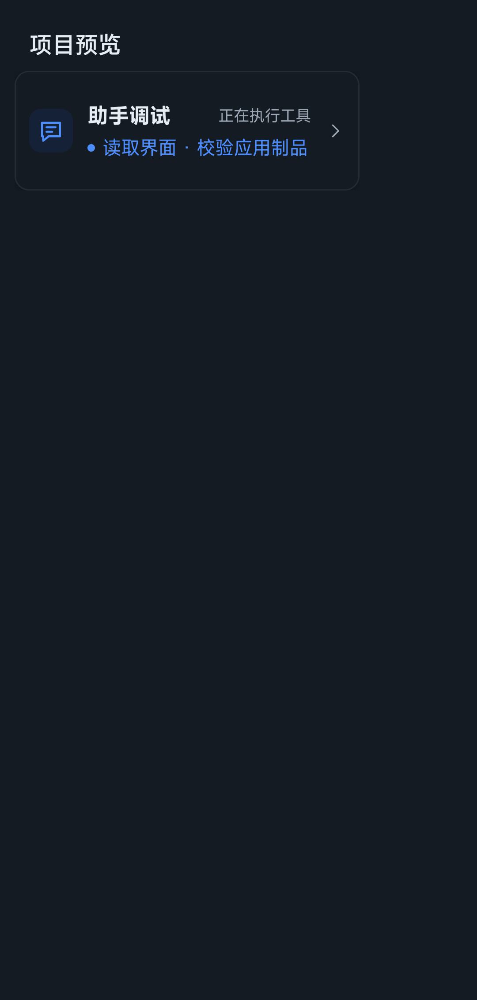 |
| 详情 | 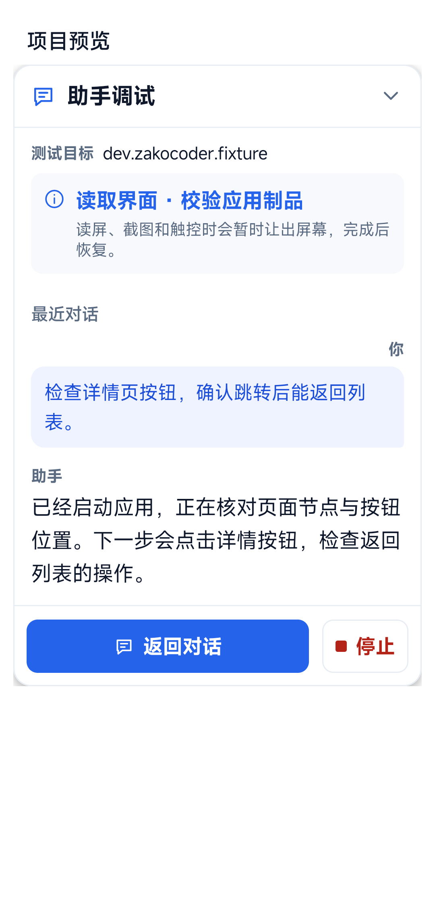 | 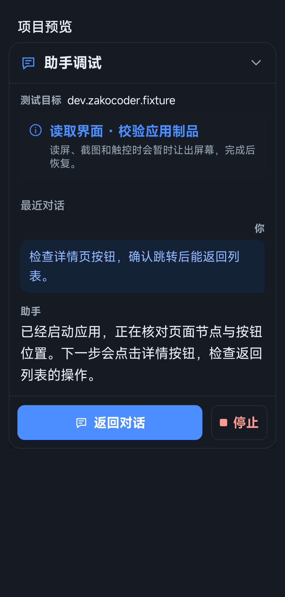 |
| 阅读长消息 | 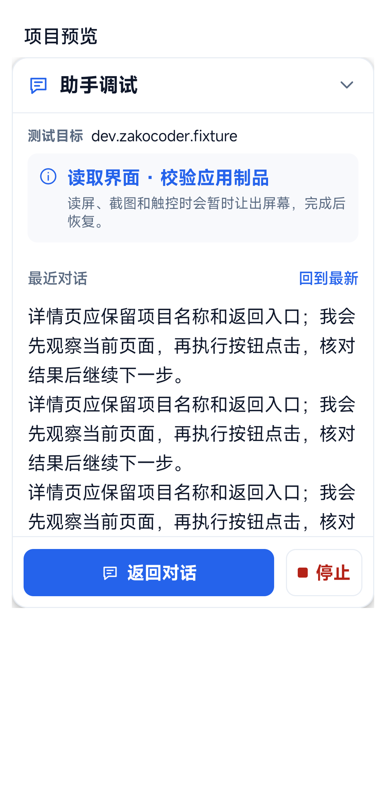 | 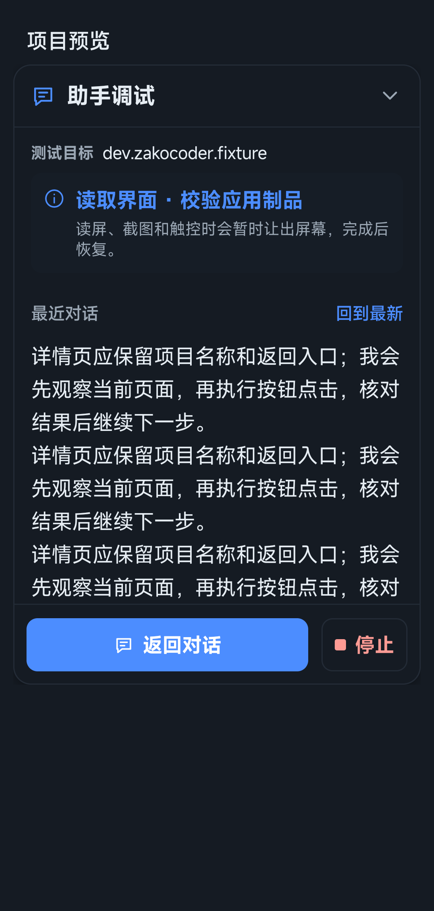 |
| 暂隐让屏 | 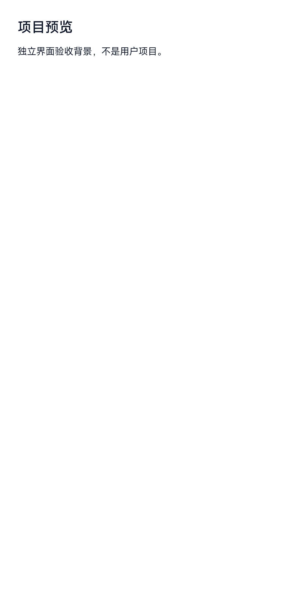 | 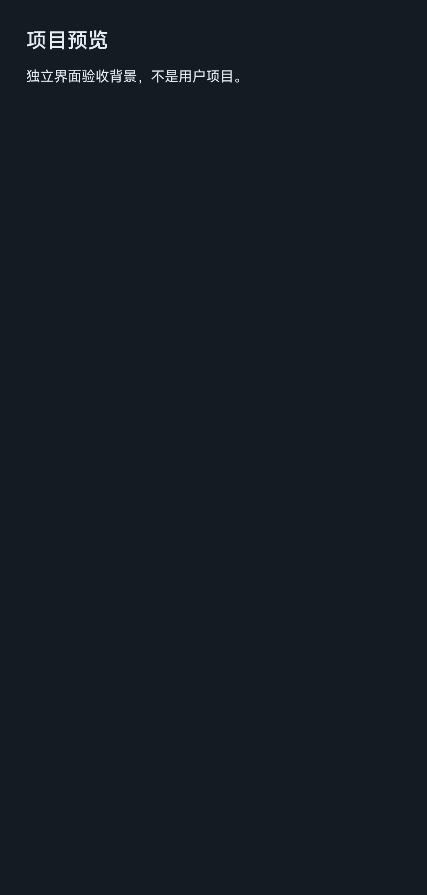 |
| 恢复详情 | 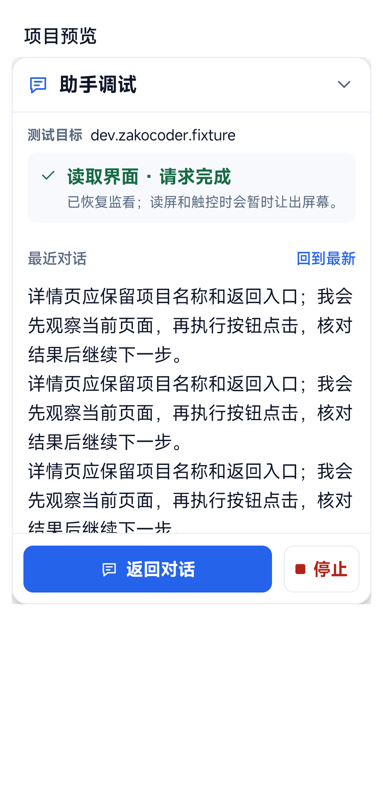 | 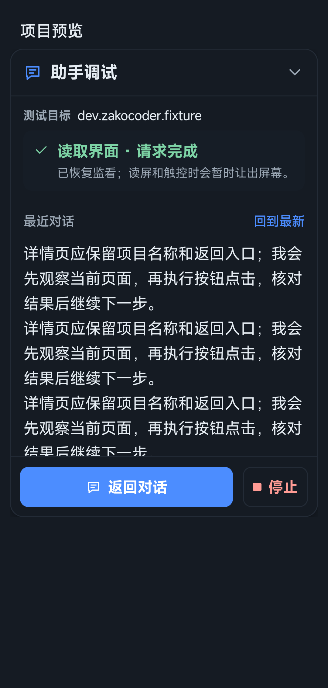 |
| 收起后结果 |  | 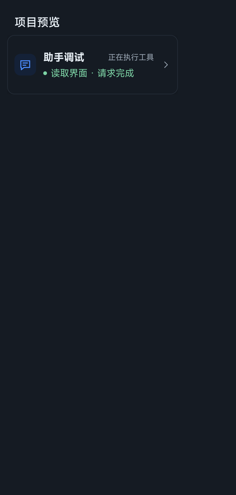 |
| 失败状态 |  | 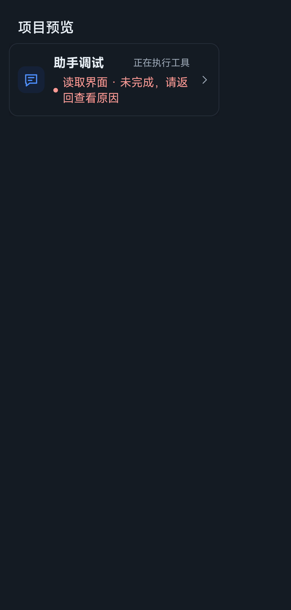 |

横屏详情与默认监看卡：

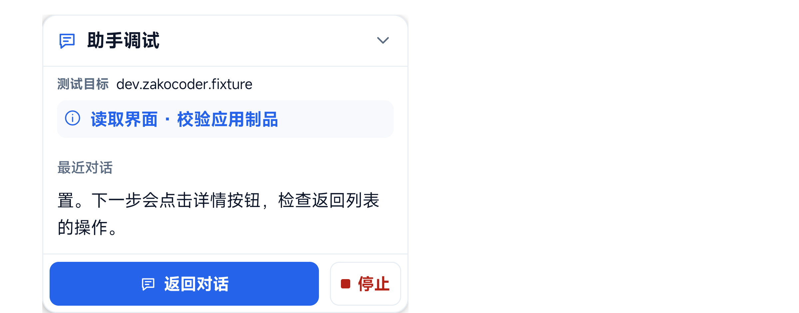


全部 24 张截图位于同一目录，包含新目标及恢复中间态。
