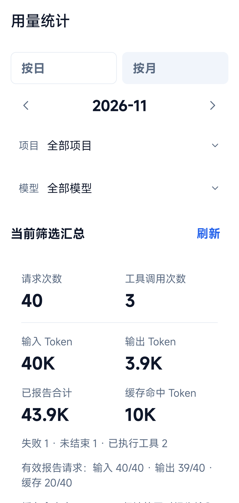
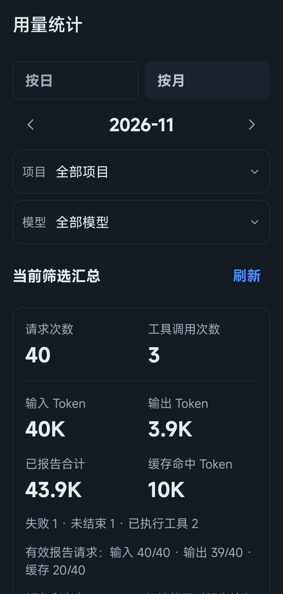
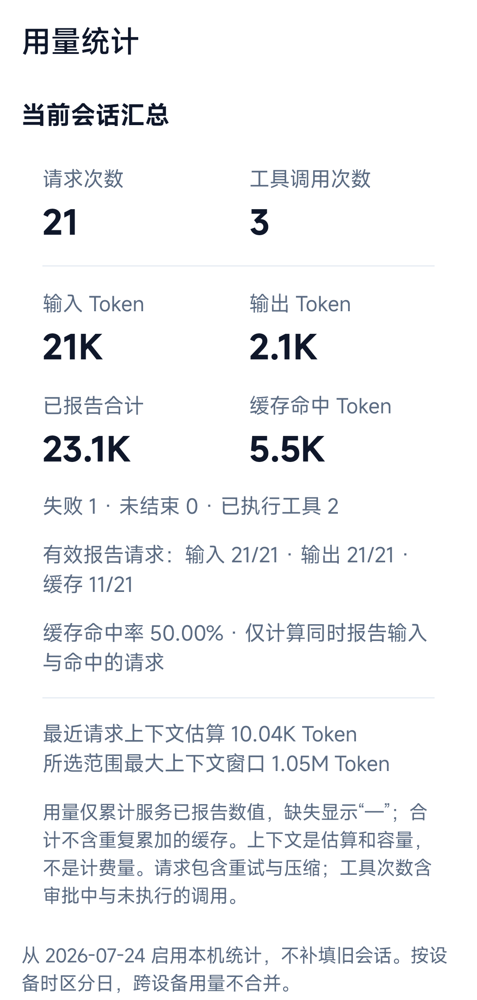
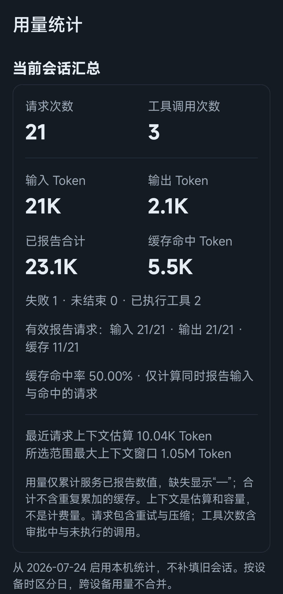
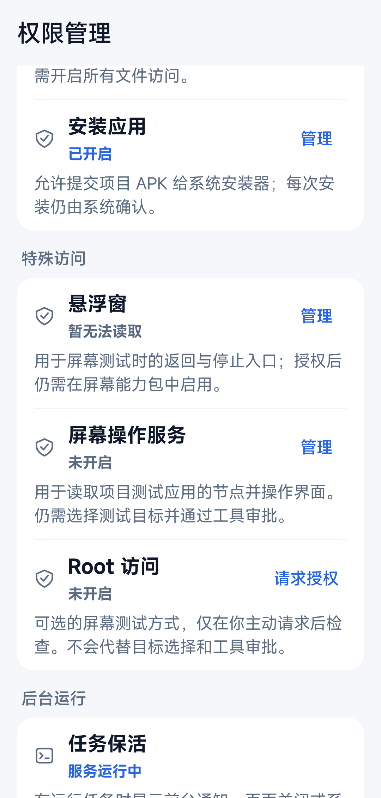
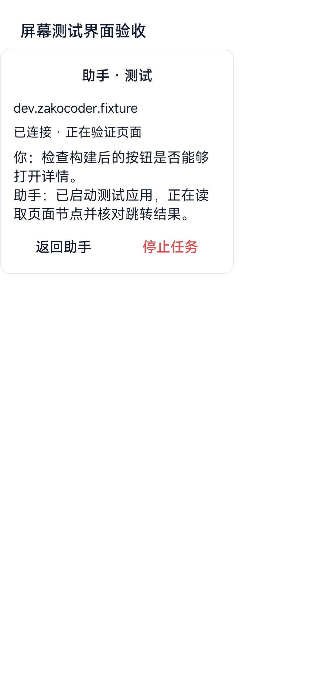
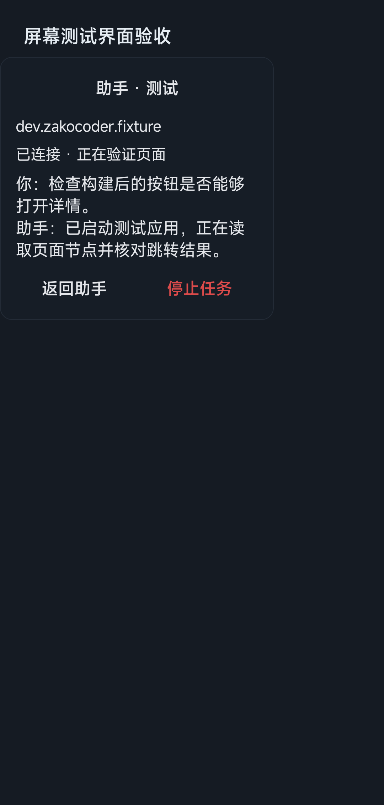
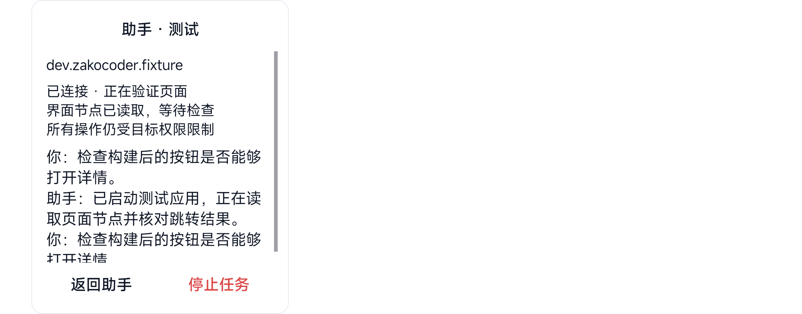

# 用量、消息操作与屏幕测试验收

日期：2026-11-01。范围：本次提交的消息操作、独立用量账本、设置权限入口、测试目标提议、后台服务和悬浮窗。既有构建链、商业模型决策和全部设备兼容性不包含在本次验证结论中。

## 实际行为

- 聊天轮次统计分为两行：输入／输出／合计，时间／速度／缓存。缺失的服务用量保持未知，缓存比例要求可比较的输入。
- 点击消息可复制、编辑重发、重新生成及查看会话请求。重发创建新分支，保留原会话；文件和外部副作用不回滚。原始引用快照可在重启后恢复，长引用不会被误当作超长输入拒绝。
- 请求页显示当前会话汇总，设置提供按日／月、项目和模型筛选的本机用量。统计独立于 32 条诊断详情及会话删除，保留范围和缺失覆盖率明确显示；遗漏标记不会被后续成功刷新清除。
- 设置集中管理系统权限与后台运行入口，Root 仅在主动请求后检查。AI 工具规则、APK 目标确认和系统权限分别生效。
- AI 可发现项目 Debug APK，提出真实包名、相对路径和摘要供确认；确认前后摘要变化会拒绝，系统安装确认不会被自动点击。
- 屏幕测试不依赖悬浮窗开启来维持前台服务。执行任务时持有有超时并续期的 CPU 唤醒锁，审批等待与空闲时释放；停止或服务结束不自动重放操作。
- 悬浮窗默认收起，展开后显示当前目标、任务状态和公开对话摘录；不显示思考、不附带用户文件引用正文或原始工具输出。正文限高滚动，返回和停止固定在操作区，目标切换重新收起。
- 超时按制品校验、画面同步及后端命令区分；界面显示中文阶段，审计保留阶段代码。读写和交互均不因超时自动重放。

## 验证方法与适用范围

真机使用 Android 13、ARM64，在独立 `dev.zakocoder.app.runtimecheck` 包验证，不修改正式应用、商业模型配置或用户项目。协议测试使用本地 TLS 服务及独立历史、权限和账本目录。屏幕目标测试使用仓库自有 Debug fixture。

构建与检查使用 `-PruntimeVerification=true`，执行应用及仪器测试 APK 编译、Android Lint、应用 JVM 测试、终端库 JVM 测试，以及仓库结构／XML／文档链接／忽略规则检查。后续仅对新增变更重跑对应编译和定向测试。

设备测试覆盖：原会话保留与重发、IO 分叉时变忙的恢复、长引用历史恢复、用量去重／重读／保留范围／损坏不覆盖／永久遗漏提示、真实控制器审批与记账时钟、APK 提议和租约变更、权限读取与运行时请求白名单、正常模式前台服务、HOME 后 30 秒同进程和目标保留、CPU 唤醒锁持有与释放、停止服务清理，以及 Root 窗口解析器。后台测试只证明该设备这一时段，不承诺永久存活。

UI 验证使用原生实际组件与测试期内存状态，在 360dp、130% 字体下检查日间和夜间的统计、菜单、编辑及确认、看板筛选／空／错误／加载／保留范围、权限分组和悬浮窗。状态 fixture 仅用于显示及交互验证，不是生产预置数据，不证明商业模型做出过这些操作。横屏测试使用真实设备旋转与长正文，核对系统安全区及滚动前后操作按钮位置，并恢复原旋转设置。

该设备横屏时，UiAutomation 返回的悬浮窗节点边界与实际 View 屏幕位置存在偏差；测试同时记录两者，用真实 View 屏幕坐标严格验证系统安全区及滚动后按钮固定，并通过无障碍节点实际展开、滚动和停止。没有把节点坐标用于坐标点击，也未声称此设备的无障碍坐标映射已修复。

系统栏没有随所有 Compose fixture 强制切换主题；截图仅证明应用内容的夜间显示，不据此宣称整机系统栏主题已验证。归档图裁去系统状态栏及导航栏，未替换或拼造应用内容。测试使用的悬浮窗及后台启动临时 AppOp 在结束后恢复原值。

## 限制

本轮未重新验证 Root／无障碍通道的完整安装、节点交互与截图闭环；现有对应测试仍是独立验收入口。没有把所有获取超时认定为系统结束后台，也没有宣称前台服务能阻止强行停止或所有厂商的进程回收。

用量不是供应商账单，不补填启用前历史、不跨设备合并。持续写盘失败且进程退出时，不能保证最后的记录及遗漏标记已保存。系统安装、无障碍及 Root 授权仍需用户决定。

## 界面归档

截图来自上述独立真机测试包，使用内存 fixture，非真实用户会话。每组均有日间和夜间；以下列出主要状态，目录保留编辑、确认、筛选、空白、错误、加载及保留范围等中间态。归档与本报告同一提交。

| 页面 | 日间 | 夜间 |
| --- | --- | --- |
| 轮次统计 |  |  |
| 消息菜单 |  |  |
| 用量看板 |  |  |
| 会话汇总 |  |  |
| 权限管理 |  |  |
| 后台运行 |  |  |

## 检查结果

- 阶段合批执行应用 327 项及终端库 145 项 JVM 测试，全部通过。随后增加跨项目同 ID 隔离断言，定向用量 JVM 测试 9 项通过；未因界面小修反复重跑全量。
- 应用 Debug、仪器测试 APK 编译、Android Lint、`python3 scripts/check_repository.py` 及 `git diff --check` 通过。
- 真机分批定向执行，共 41 个不同用例通过，重复运行不重复计数。最终悬浮窗日间／夜间／横屏 3 项全部通过；用量看板项目隔离修复后日间／夜间 2 项通过；用量控制器及存储 5 项通过。

构建命令：

```sh
./gradlew -PruntimeVerification=true \
  :app:assembleDebug :app:assembleDebugAndroidTest :app:lintDebug \
  :app:testDebugUnitTest :terminal-emulator:testDebugUnitTest
python3 scripts/check_repository.py
git diff --check
```

用量定向补测：

```sh
./gradlew -PruntimeVerification=true \
  :app:testDebugUnitTest --tests '*AiUsage*'
```

设备通过 AndroidJUnitRunner 按上述模块合批执行；不要求普通用户开启仪器测试权限。完整 Root／无障碍流程不包含在本轮通过数量内。

| 悬浮窗状态 | 日间 | 夜间 |
| --- | --- | --- |
| 展开对话 |  |  |
| 收起入口 |  |  |

横屏长正文与固定操作区：



共归档 43 张真实设备截图。测试结束后，隔离测试包的悬浮窗及后台启动 AppOp 已恢复为原来的 `ignore`，设备旋转设置已恢复；未修改正式应用的配置和项目。
