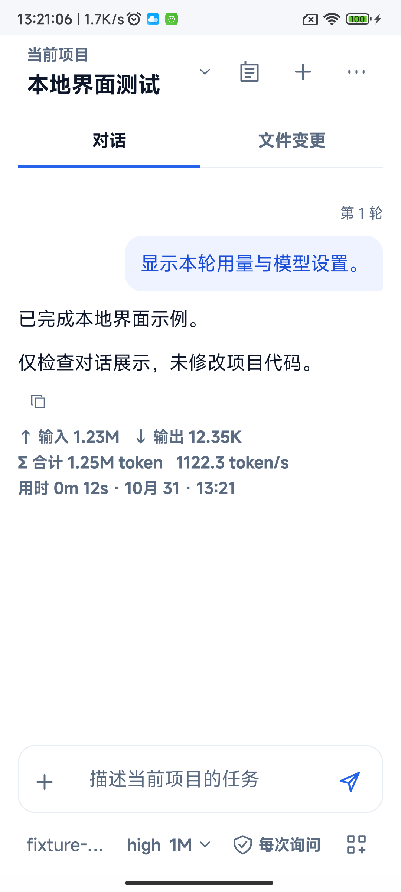
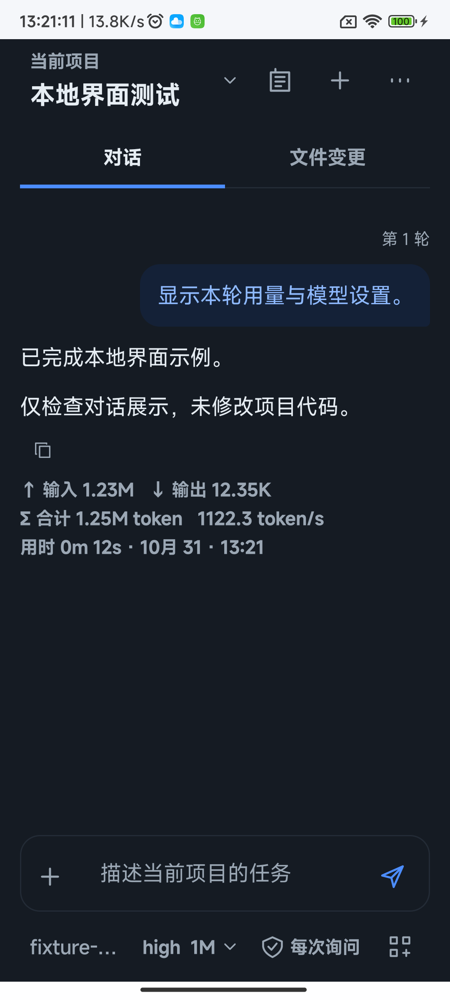
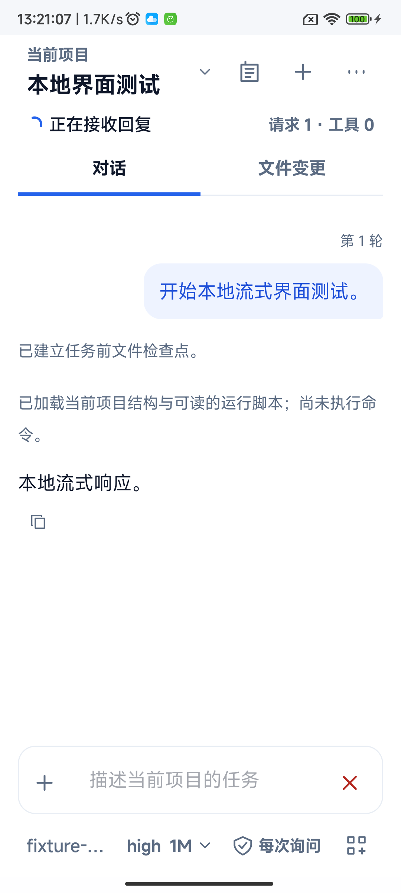
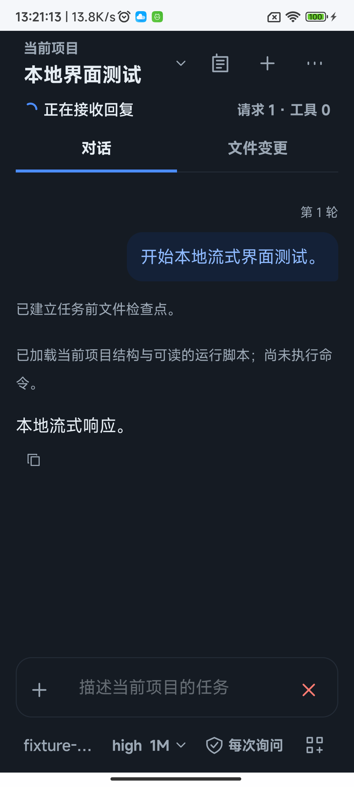

# 聊天模型栏及 Token 汇总展示

本轮仅调整 Kotlin + Compose 原生聊天页展示，沿用工作台日夜配色与既有模型选择 sheet。

## 行为

- 输入框下方按模型名称、思考配置、上下文窗口顺序显示，如 `deepseek-flash · high · 1M`；服务默认显示“默认”，关闭思考显示“关闭”，未配置模型时仍提示选择模型。
- 模型入口整体仍可点击；48dp 最小触区，长模型名称单行省略，思考与上下文保持可见，无障碍状态说明包含两者含义。
- 执行中不再在输入框上方增加 Token 统计。已结束回合末尾继续显示输入、输出、合计、速度和耗时。
- 回合汇总采用十进制 K/M，最多两位小数并去除尾零，例如 `999`、`1K`、`12.35K`、`1.23M`。计算仍使用原始 Long，用量记录及单次请求列表／详情保留精确值。
- 聊天末尾移除“部分请求未提供用量或已超出保留范围”提示。未知数据仍为 `—`，不补造 0，也不扩大历史保留范围；汇总仅涵盖当前保留的已知请求用量。

## 截图来源与布局检查

设备为 Android 13 ARM64 真机，360dp 布局、130% 字体压力条件；系统状态栏保持设备原主题，应用内容分别通过原生主题提供日夜配色。截图对应 `e56143bc` 基线加本地未提交变更，不表示已经合并。

截图使用独立 UUID 私有目录、独立配置及本地 TLS SSE 测试服务，不含用户真实项目、配置或对话，不调用商业模型。大数用量是测试服务返回的受控字段，12 秒时长为测试夹具设定；仅用于检查 K/M、换行和布局，不能作为真实模型速度或计费证据。执行态截图在实际本地流式请求未结束时拍摄，随后停止该测试任务。

| 场景 | 日间 | 夜间 |
|---|---|---|
| 已结束回合、大数汇总 |  |  |
| 执行中、无输入区用量 |  |  |

## 验证

- `:app:assembleDebug`、`:app:assembleDebugAndroidTest`、`:app:lintDebug` 通过；已覆盖安装 Debug APK 到真机。
- `:app:testDebugUnitTest --tests dev.zakocoder.app.AiTurnUsageTest`：3 项通过。
- `AiConversationUiDeviceTest#footerKeepsUnknownUsageHonestAndShowsKnownTotalsAndDuration`：1 项通过，覆盖未知值、小整数、1.23M／12.35K／1.25M、耗时与提示移除。
- `AiComposerUsageUiDeviceTest`：2 项通过，11.469 秒；分别检查日夜模式完整聊天页、360dp／130% 字体、模型三字段、实际流式执行态及上述四张截图。
- 初次截图测试的执行态因 MockWebServer 同时限速请求上传而超时；改为仓库已有 ResponseOnlyDispatcher，只限制响应后，两项均通过。产品代码无需为该测试故障调整。
- 仓库结构／XML／本地链接／忽略规则与 `git diff --check` 通过。未重复全量设备回归或付费模型验收。
