# 编码交互与流式稳定性验收

本轮实现和本地验收完成，供 PR 审核；尚未合并。修改前基线为 `ad687bf`，最终实现已整合主分支 `9f0153f` 的系统提示词与模型推荐上下文功能。

## 行为变化与基线证据

同一回归用例在基线实际复现以下四项问题，并在修改后通过：

| 场景 | 修改前实际结果 | 修改后 |
| --- | --- | --- |
| 当前模型容量 1050000，加载容量 64000 的旧会话 | 容量被旧会话覆盖为 64000 | 保持当前模型容量及输出预留 |
| Chat Completions 一条 SSE 数据跨多行 | JSON 协议解析失败 | 按完整 SSE 事件解析 |
| 用量字段为非数字字符串 | 未拒绝无效统计 | 明确拒绝无效用量，缺失和零分别处理 |
| 保存本地 HTTP 网关配置 | HTTPS 校验拒绝，未发出请求 | 支持本机和 RFC1918 IPv4 HTTP，真机完成模型获取和流式工具探测 |

长代码默认显示 12 行预览，提供展开与复制；完整有界消息复制原代码，超长消息明确标注复制预览。阅读思考或主动展开内容时暂停跟随，返回最新后恢复；新增输出不会替换正在阅读的思考片段。模型参数、上下文和请求头错误在对应字段展示，真实键盘打开后仍可纠错保存。

HTTP 仅放行 localhost、127.0.0.1、[::1] 和 RFC1918 私网 IPv4；公网 HTTP、其他域名和非回环 IPv6 不在本轮支持范围。换协议、主机或有效端口均视为换源，不能直接复用原密钥和请求头。

## 界面对比

Android 13 ARM64 真机，独立测试包，360dp 布局与 130% 字体；相同隔离夹具采集，不读取用户配置、会话和密钥。全部 21 张图片已经独立逐图审查。

| 状态 | 修改前 | 修改后 |
| --- | --- | --- |
| 日间长代码 | 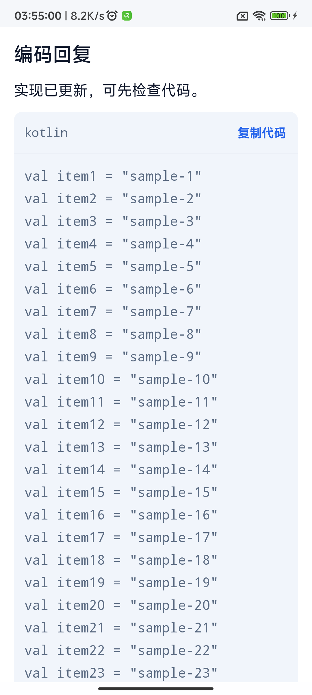 | 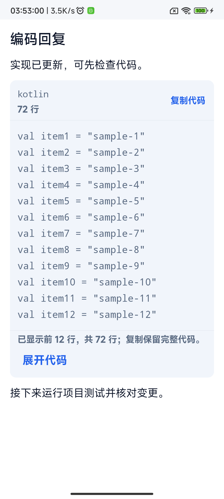 |
| 夜间长代码 | 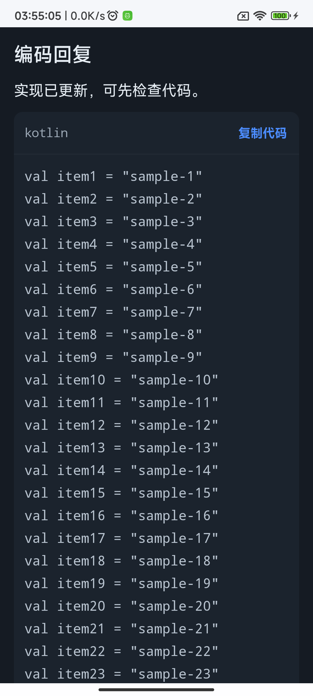 | 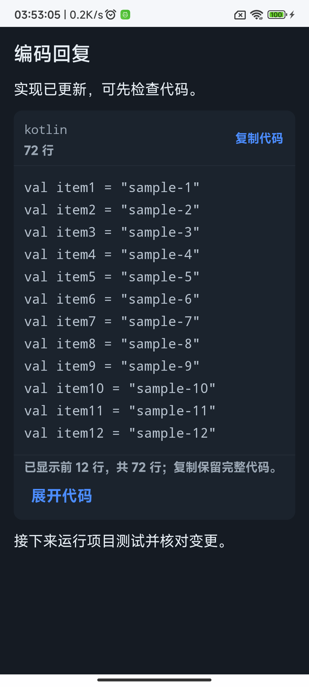 |
| 日间思考阅读 | 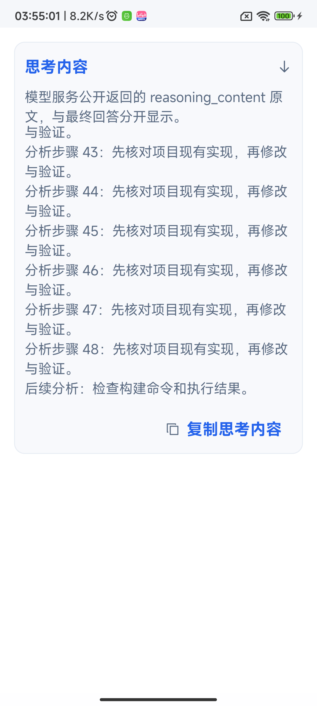 | 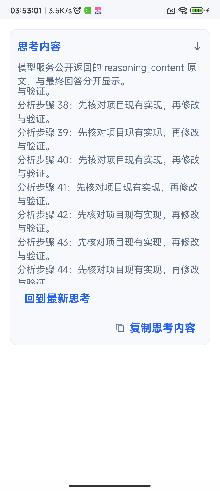 |
| 夜间思考阅读 | 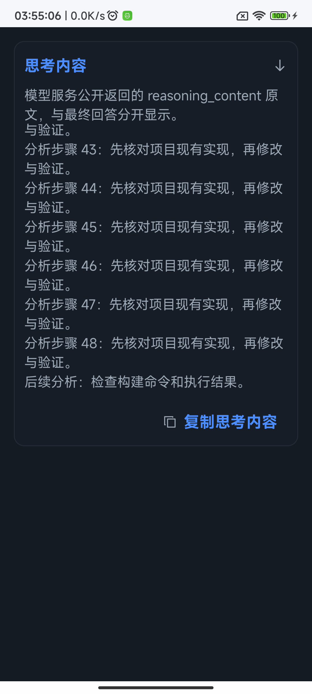 | 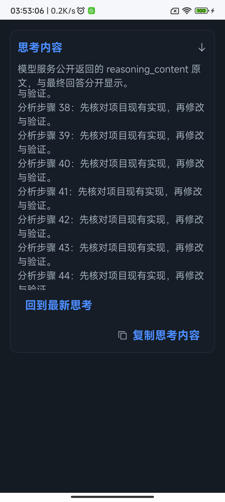 |
| 日间参数校验 | 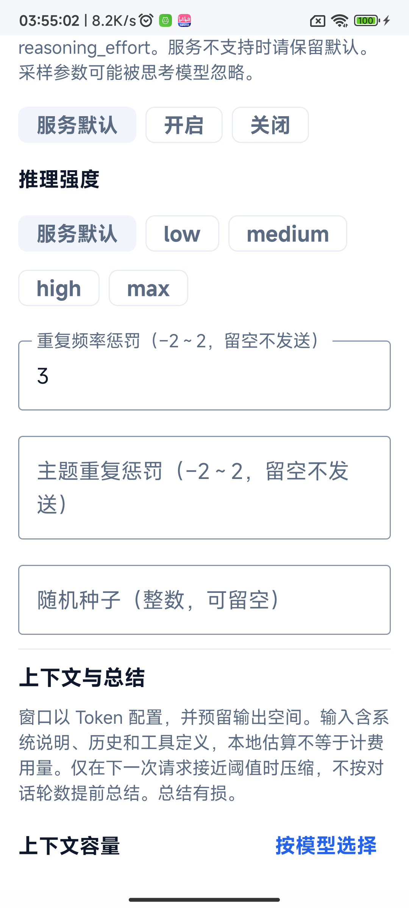 | 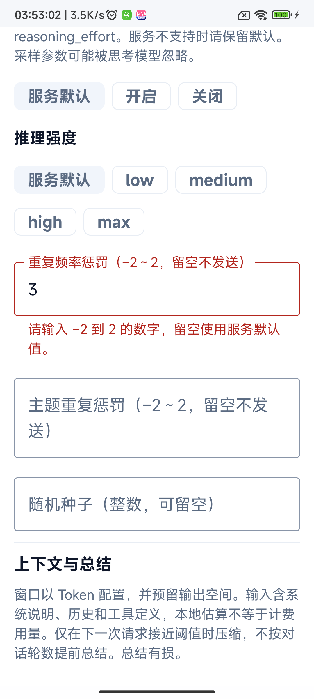 |
| 夜间参数校验 | 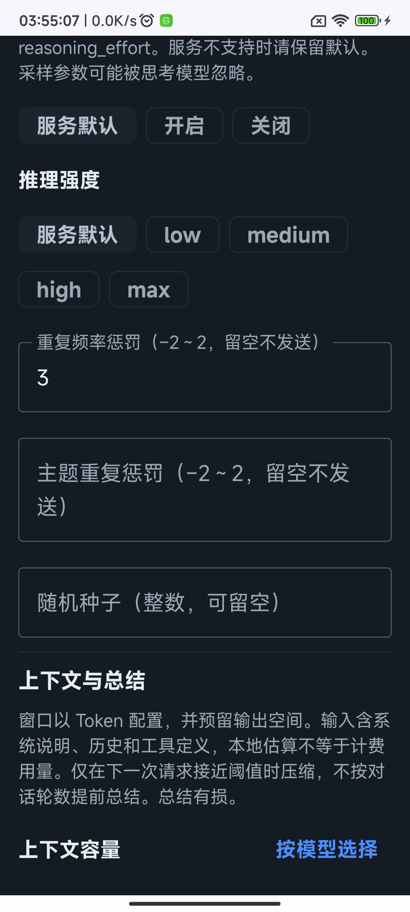 | 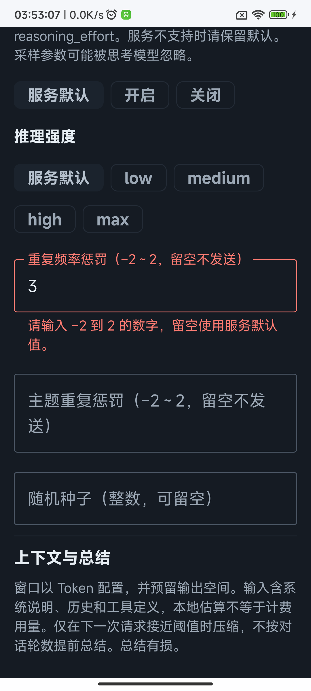 |
| 日间上下文校验 | 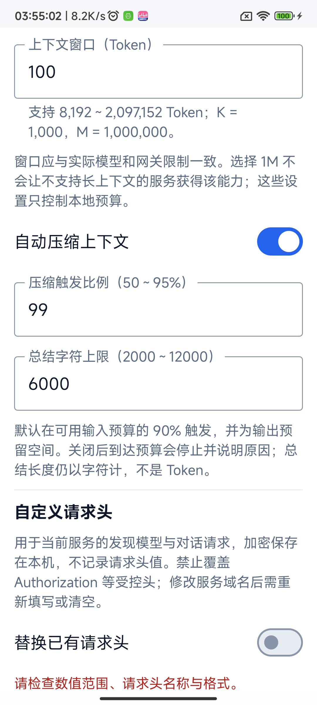 | 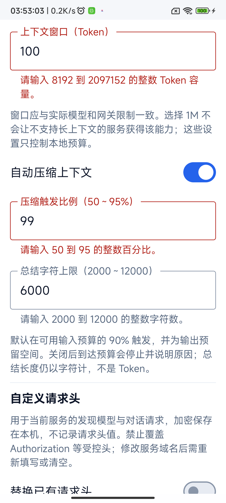 |
| 夜间上下文校验 | 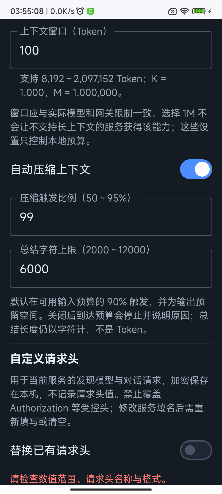 | 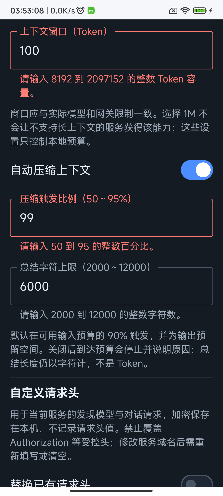 |
| 日间请求头校验 | 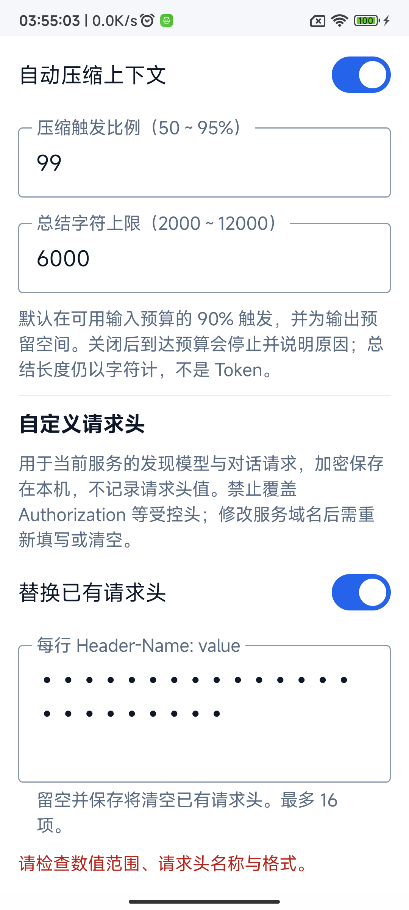 | 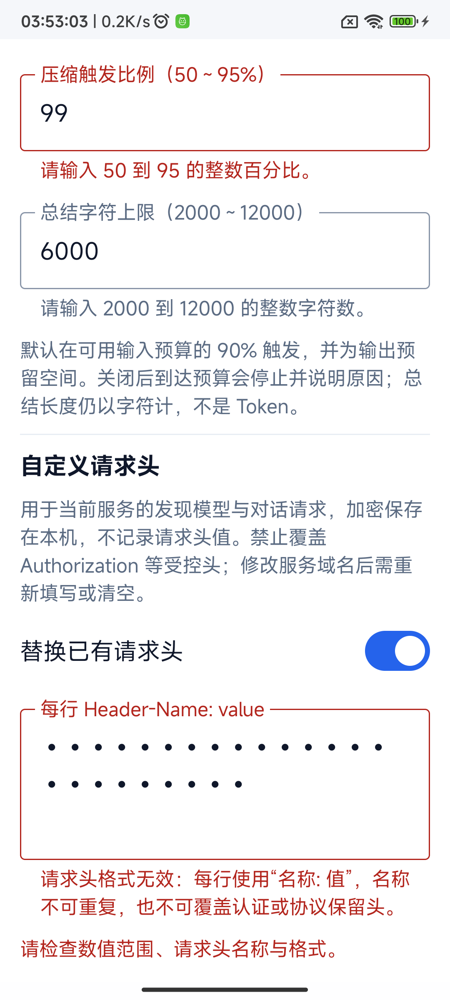 |
| 夜间请求头校验 | 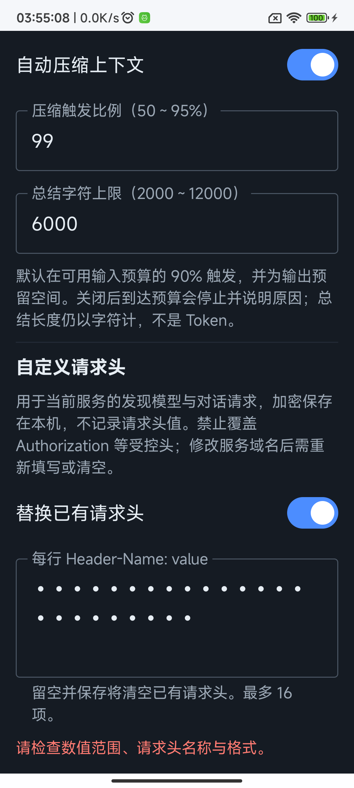 | 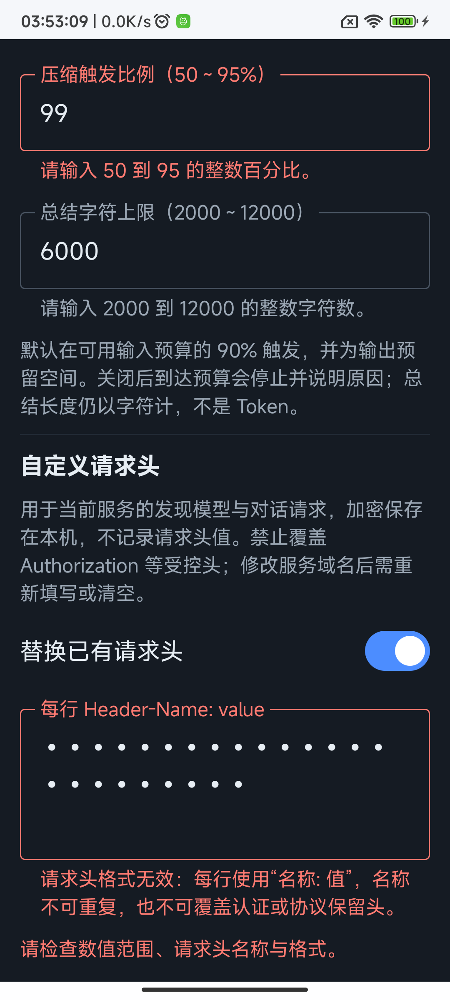 |

真实输入法补充图：

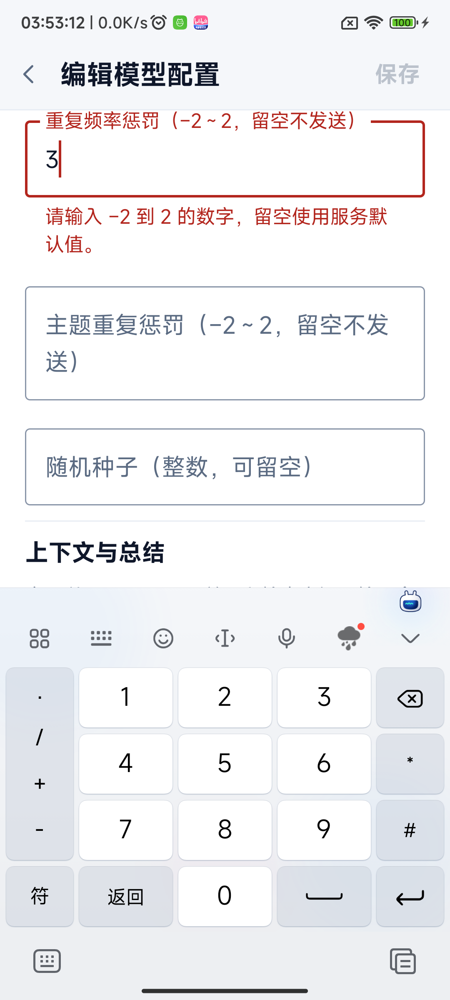

夜间图证明组件夜间配色；隔离夹具的系统状态栏和导航栏仍为浅色，不能据此证明整页系统栏适配。参数与上下文截图包含正常滚动裁切，展示对应字段状态，不代表整个编辑页同时可见。键盘补充图为日间，主要位置均另有日夜成对截图。

## 实际验证结果

- `python3 scripts/check_repository.py` 与 `git diff --check` 通过。
- Debug APK、测试 APK 和 Lint 构建通过。
- JVM：应用 313 项、终端库 145 项，共 458 项通过，无失败、错误或跳过。
- 真机定向批次合计覆盖 98 项不同用例，最终均有通过记录：核心协议／会话／上下文／HTTP 50 项，协议线格式及图片历史 29 项，项目规则 12 项，阅读与设置交互 7 项。此数量按用例去重，不将重跑重复计数，也不是声称单批运行 98 项。
- 规则测试修正旧夹具：从最新的追加规则段读取，保留旧前缀字节一致断言；压缩用例显式设置 80000 Token／50% 并验证真实摘要、规则与文件写入。最末定向批次 4 项全部通过。
- 独立审查已核对实现、与主分支功能的集成及全部截图，无遗留阻塞项。

可复现的构建命令（SDK 路径按本机调整）：

```sh
./gradlew -PruntimeVerification=true :app:assembleDebug :app:assembleDebugAndroidTest :app:lintDebug :app:testDebugUnitTest :terminal-emulator:testDebugUnitTest
```

设备测试使用 `dev.zakocoder.app.runtimecheck` 独立包及 AndroidJUnitRunner。覆盖类包括 `AiSessionOwnershipDeviceTest`、`AiStreamBoundaryDeviceTest`、`AiLocalHttpProviderDeviceTest`、`AiConversationContinuityDeviceTest`、上下文与缓存测试、四协议 transport/wire 测试、`AiProviderPromptDeviceTest`、图片历史定向测试、`AiScopedRulesDeviceTest` 及两组阅读 UI 测试。日夜截图使用 `AiReadingUiDeviceTest` 同一夹具在前后版本采集。

## 保留机制与边界

| 范围 | 验收依据 |
| --- | --- |
| 流式协议 | 公共 SSE 分帧的换行、分片、大小限制、取消与不完整 EOF；各协议独立判定完成，未完成的工具调用不释放 |
| 会话归属 | 排队保存与删除、历史权限撤销、任务配置快照及下一任务读取新配置 |
| 上下文 | 工具调用和结果成组、压缩失败不重放、停止摘要、禁用压缩、长历史重载与图片元数据保留 |
| 阅读展示 | 展开、分页、复制、用户暂停和恢复、思考窗口限制与 UTF-16 边界 |
| 设置 | 字段校验和存储约束一致，系统提示词、推荐容量保留，真实键盘纠错保存 |
| 工作区 | 保留路径、符号链接、文件基线和用户后续修改保护，执行既有相关 JVM 回归；没有新增宿主 Shell 通道 |

无新增权限、依赖或数据迁移，不另建任务或配置系统。实际设备覆盖限 Android 13 ARM64；没有扩展到其他 Android 版本、横屏或 TalkBack。网络测试使用本地隔离协议夹具，没有验证付费云服务；HTTP 实际请求覆盖 Chat Completions 回环网关，私网 IP 放行由校验测试覆盖，未连接真实局域网服务器。不宣称全部协议与异常的笛卡尔积兼容，也没有重新安装 Ubuntu 或验证新的外部服务部署。
