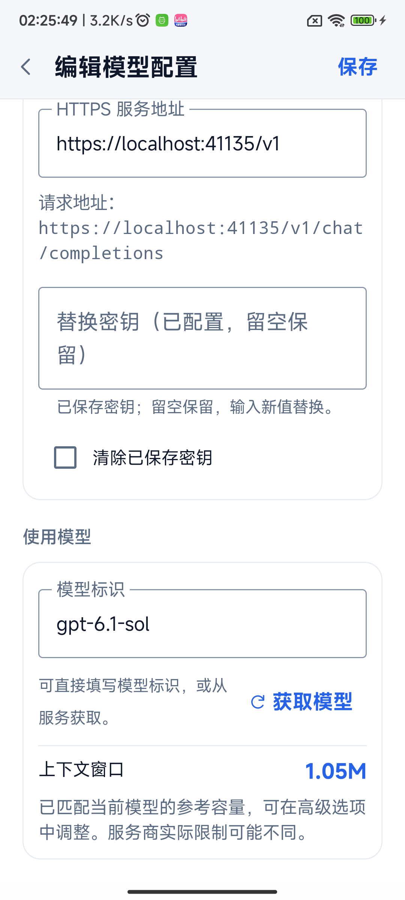
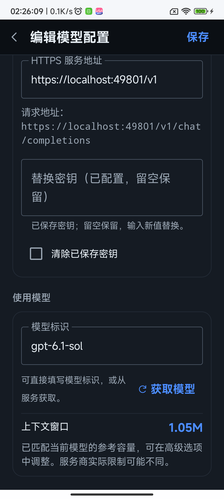
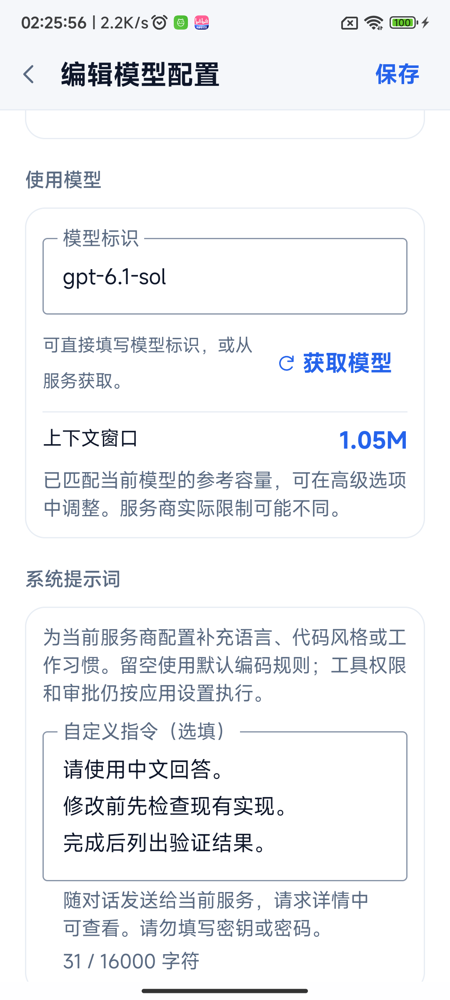
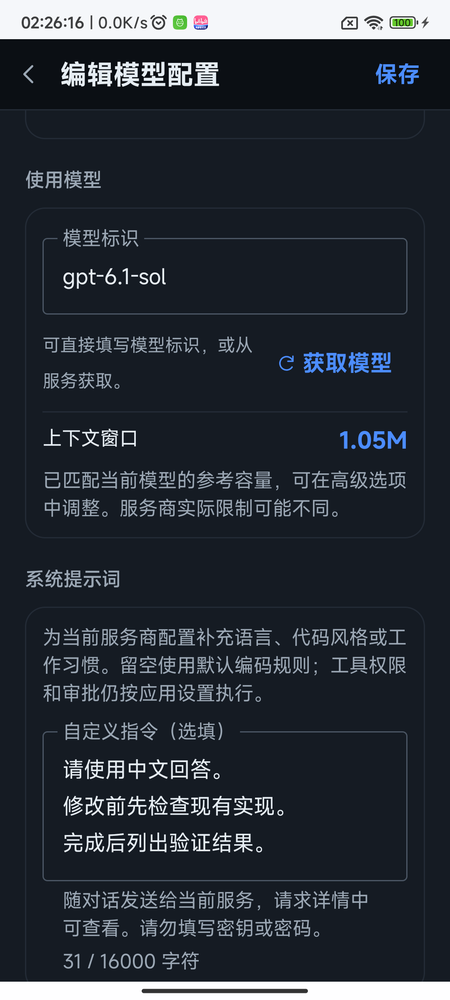
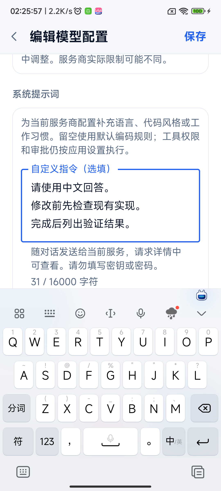
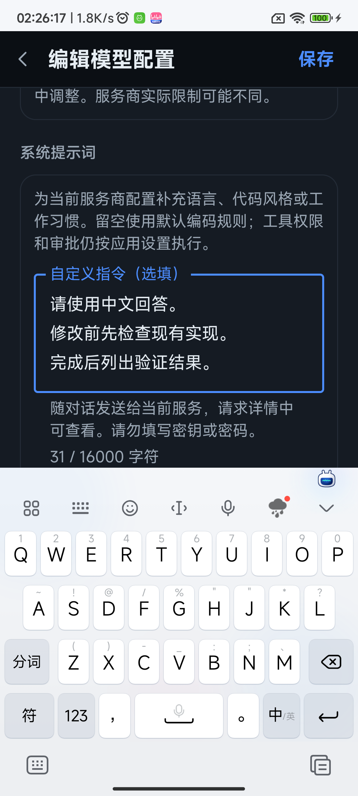

# 服务商系统提示词与模型上下文

## 本次行为

- 在现有服务商／模型配置编辑页新增可选的「系统提示词」，沿用原生 Compose 表单及工作台日夜配色。每个配置独立保存，留空使用默认编码规则；清空后保存会移除该配置的补充指令。
- 自定义内容补充在应用默认编码指令之后，不替代工具权限与审批。当前任务使用开始时的配置快照，工具多轮调用及上下文压缩后仍保留；编辑后的提示词从下一任务生效。
- 提示词最多 16,000 字符。超长粘贴不会静默截断，显示长度及错误并禁止保存；退出未保存的修改需确认。提示词会发送给所选服务商，也会出现在本地请求详情，界面明确提示不要填写密钥或密码。
- 新建配置选模、或已有配置实际更换模型时，使用同一份型号参考表设置上下文。`gpt-6.1-sol` 为 1,050,000 tokens，显示 `1.05M`。手填与获取模型列表选择行为一致，支持 `provider/model` 路由前缀及大小写归一。
- 旧配置、重新打开、重复选择同一模型保留已有手动值；用户仍可在高级选项覆盖。未知型号回退 128K，并明确说明尚未收录，不按相似名称猜测容量。服务商实际限额可能不同，参考容量不是服务端能力确认。

## 界面证据

对应实现提交 `6b5afd8`，基于 `ad687bf` 主线。Android 13 ARM64 真机，独立 `dev.zakocoder.app.runtimecheck` 测试安装包；内容按 360dp、130% 字体压力条件渲染。应用内容分别使用工作台日夜主题，系统状态栏与系统输入法沿用设备自身主题。未修改用户正式安装包、配置或项目。

截图由真实配置编辑器采集；配置、项目目录、密钥别名均使用隔离的测试夹具，模型列表来自本地 HTTPS MockWebServer。截图中的 localhost 地址及提示词为合成测试数据，无外部模型请求、真实凭据或用户会话。

| 改动位置／状态 | 日间 | 夜间 |
| --- | --- | --- |
| 换模后自动匹配 1.05M |  |  |
| 多行自定义提示词、说明及字符计数 |  |  |
| 实际系统键盘弹出后输入与保存 |  |  |

键盘态测试等待系统 IME 确实可见，再检查输入框完整可见、底部不被键盘遮挡及顶部保存入口可见。已人工核对截图，未用单纯语义文本赋值代替键盘证据。系统状态栏与导航区安全边距保留。

## 验证

- `ANDROID_HOME=/home/sking/Android/Sdk ./gradlew -PruntimeVerification=true :app:assembleDebug :app:assembleDebugAndroidTest :app:lintDebug :app:testDebugUnitTest :terminal-emulator:testDebugUnitTest`：通过。更新主线后 app 单元测试 293 项、终端模拟器 145 项，均无失败；Lint 无 Error。
- `python3 scripts/check_repository.py`、`git diff --check`：通过；仓库脚本单元测试 85 项通过。
- 真机 `AiProviderPromptDeviceTest`、`AiModelsDeviceTest`、`AiProtocolStoreDeviceTest`：共 13 项通过。其中新增 4 项覆盖多配置隔离保存／清空／兼容入口、旧格式缺失字段、长度限制、四协议真实 HTTPS 请求体，以及实际工具执行、压缩与下一任务重新加载。
- 四协议为 Chat Completions、Responses、Anthropic Messages、Gemini；检查实际请求路径、对应 system 字段、内置编码规则及自定义提示词只加入一次。测试服务为本地 TLS，不代表商业服务端验收。
- `AiProviderConfigUiDeviceTest`：日夜各 1 项通过。覆盖原配置 256K 保留、手填换模 500K／1.05M、手动 64K、列表重选保留 64K、列表换模 1M、多行编辑、16,001 字符错误、保存重开、丢弃修改、清空，以及真实键盘布局。
- 首轮 UI 测试发现测试自身重新打开页面时未等待新组合完成，已使用页面代次与 `SideEffect` 同步；产品代码未因该测试时序故障改动。更新主线后使用最终 APK 重跑日夜截图与交互。
- 设备后台冻结曾干扰纯配置测试进度；测试时临时前台启动授权及系统冻结设置均恢复原值，未将设备特定行为写入产品说明。测试启动辅助函数改用目标安装包名，避免带后缀的独立测试误启动正式应用。

## 兼容范围

配置以可选字段增量保存，旧配置缺少字段时为空；不强制重写旧上下文。提示词作为普通配置文本保存，API 密钥及请求头继续采用原有 Keystore 加密。配置对象的 `toString()` 不输出提示词内容，用户主动打开的请求详情仍可查看实际发送内容。

没有新增权限、依赖、外部服务或第三方产品代码。本次未验证不同商业供应商的服务端行为，也未重复执行无关模块的完整真机回归。
