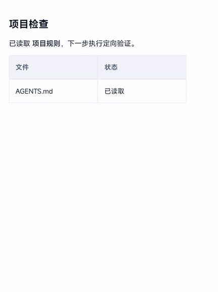
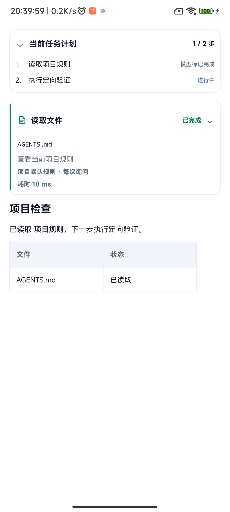
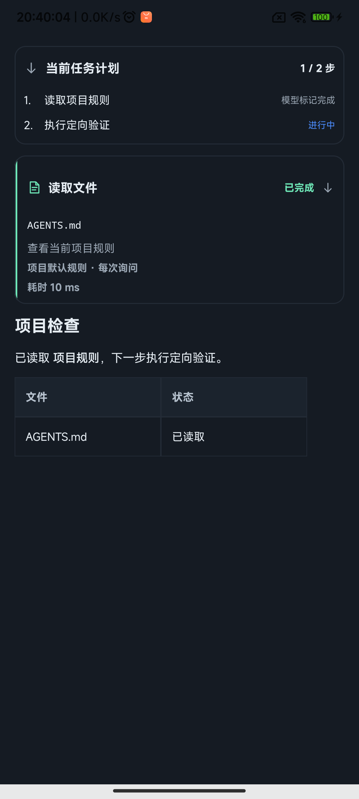

# 助手渲染与工具过渡验证

基线：`7c359c8`。设备：Xiaomi POCO F5（marble），Android 13；隔离测试包 `dev.zakocoder.app.runtimecheck`。测试使用本地固定内容，不请求模型、不读取模型凭据。下列截图和录屏展示实际 Compose 组件，由仪器测试驱动状态变化，不代表一次真实模型任务。

## 动效预览

GIF 从真机录屏裁剪，24fps、原速。覆盖计划出现、工具新增、运行到完成，以及计划折叠与展开；裁剪去除了无关页面和屏幕空白。GIF 用于观察过渡，不能用于测量帧率或证明所有设备无卡顿。

| 日间：计划、工具及 Markdown | 夜间：相同组件 |
| --- | --- |
|  |  |

## 实际变化

- 历史 Markdown 命中内存缓存时立即使用解析树；首次后台解析不再额外等待采样窗口。流式更新保留 main 的 64ms 采样、合流及逐字输出逻辑。
- 最多缓存 12 份文档、192,000 个源字符，不写入磁盘。内联文本复用样式结果，链接回调仍读取最新参数。
- 新时间线条目淡入及位置过渡；计划出现、折叠和展开使用短过渡；工具卡片尺寸、状态颜色与文字连续变化。动效不延迟工具执行或审批。
- 不变更接口地址规则、模型协议、权限、持久化格式或依赖。

## 前后计时

相同基线和修复版本各运行一次进程内 6 次挂载测试。内容共 9,269 字符，包含 25 段小节、代码与表格；置于 LazyColumn。计时从挂载开始，到测试观察到首个标题语义节点。首样本不保证系统或所有进程缓存为空，重复样本是在同一次测试中的重新进入。

| 指标 | main 基线 | 修复后 |
| --- | --- | --- |
| 首次挂载 | 466 ms | 404 ms |
| 重复挂载中位数 | 400 ms | 291 ms |
| 5 次重复样本 | [418, 427, 400, 370, 367] | [250, 340, 292, 288, 291] |

重复挂载中位数约减少 27.2%。不是整个助手页面打开耗时，也不是掉帧率；长文仍包含整块布局成本，结果不能外推到全部设备和任意对话。

## 验证结果

- 仓库结构、XML、本地文档链接及忽略规则检查通过；最终代码 `:app:lintDebug` 通过。
- Debug 与 AndroidTest 构建通过；`AiMarkdownTest` 8 项通过，包括 2 项新增缓存复用与容量测试。
- 真机 `AiRenderingDeviceTest` 两项通过：重入计时；日夜主题计划/工具内容及位置、折叠和展开。检查步骤必须在标题下方，折叠后节点消失，展开后恢复。
- 真机对话定向回归中：项目路径回调、长表格与列表、用量页脚 3 项通过。
- 另 2 项现有测试失败，同样在未修改的 main 基线复现：`userMessageShowsCopyOnlyAfterTap` 仍要求旧菜单宽度 ≤128dp，但当前菜单最小宽度为152dp；`activeDefaultsManualChoicesUpdatesKeyboardAndTaskIdentity` 仍查找已移除的计划说明正文。未将这两项标为通过，也未在此改动菜单或恢复旧文案。
- 未新增窄屏、字体放大和键盘组合矩阵；本次没有修改字阶、触控尺寸或页面结构，不能据此宣称这些组合已全部验收。
