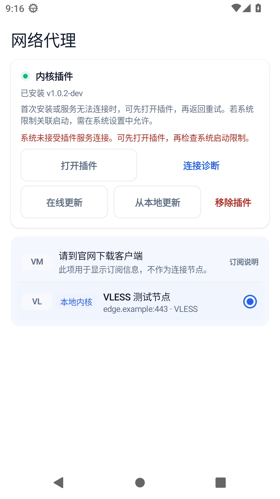
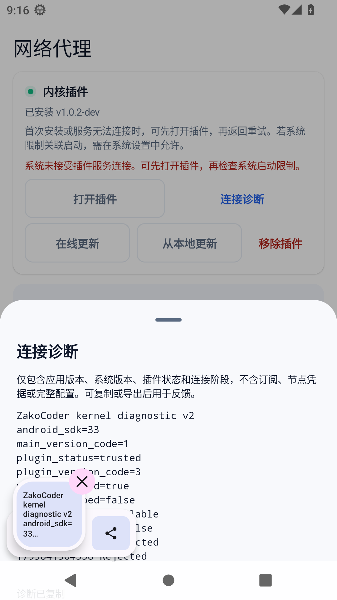
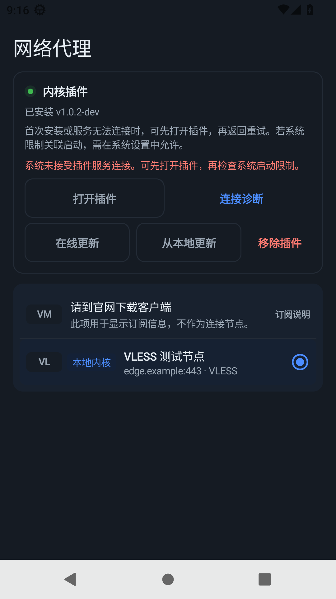
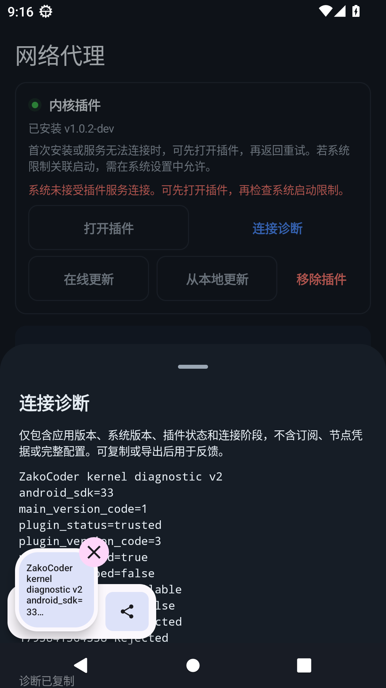
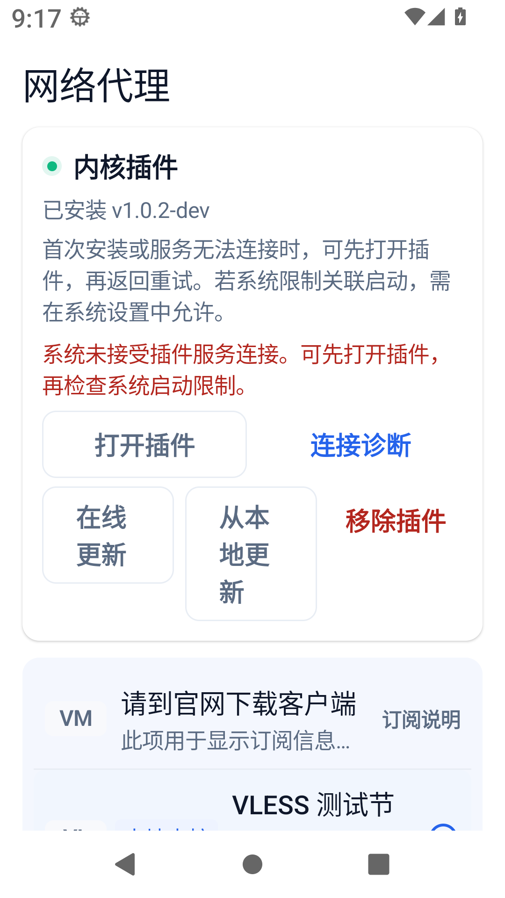
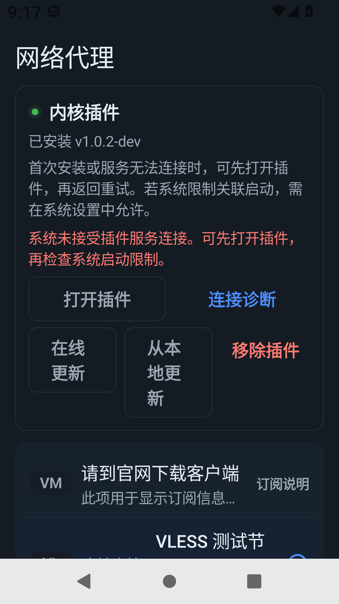
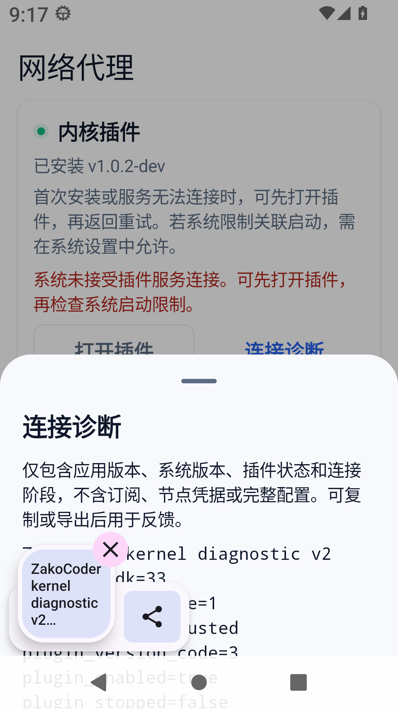
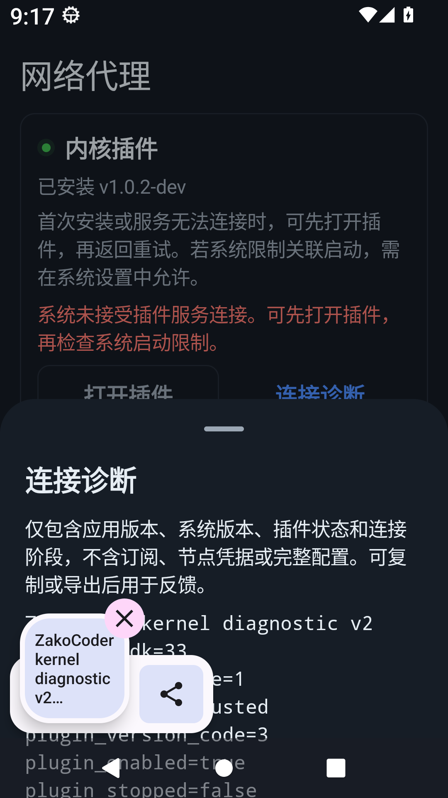
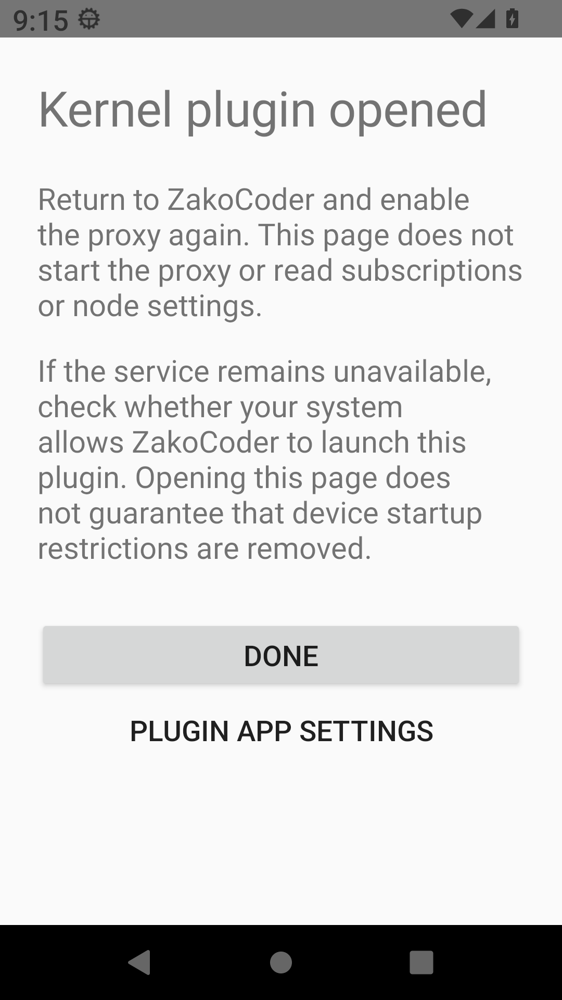
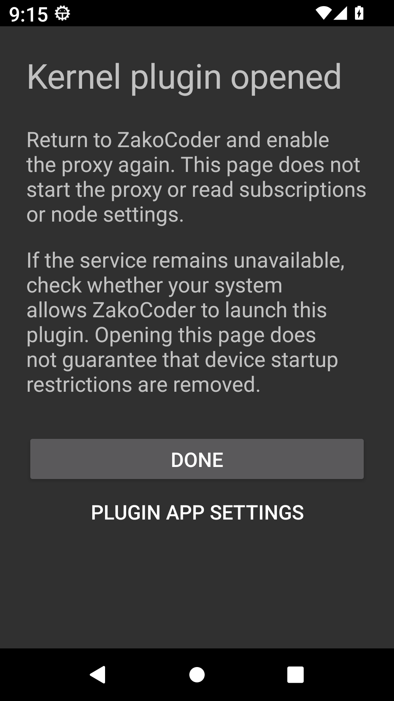

# 代理恢复与节点资格验证

基于 PR #54 `ff887b5` 追加代理修复。此目录仅记录 ZakoCoder 自有组件和测试证据，不包含真实订阅、节点凭据、用户项目或原始日志。

## 范围

- 保留 PR 的 VLESS 功能入口、版本化订阅 User-Agent、Xray 升级和“参数完整不代表联网成功”说明。
- 整合订阅占位分类、Clash 嵌套 REALITY、参数校验和缓存恢复；支持 VLESS TCP/RAW、WebSocket、gRPC、TLS/REALITY，Vision 仅用于 TCP/RAW，未实现的传输或参数明确拒绝。
- 插件激活使用前台 Activity，失败时显示具名反馈并回退系统应用详情；实际绑定失败进入恢复卡片。绑定死亡、迟到回调和停止/启动使用所属代际处理。
- Android 宿主解析节点端点，对去重地址执行有界 TCP 可达性探测并回退，保留 TLS/REALITY 服务名；诊断只暴露有界白名单类别。
- 回环占位判定覆盖压缩 IPv6、完整 IPv6、IPv4-mapped 形式，不进行 DNS 查询；手动单节点链接保留用户意图。
- 不包含工作区的 AI、导航、通用视觉组件、其他 UI 或依赖升级。

## 实际界面

AOSP Android 13 / API 33，x86_64 只读模拟器；主测试包 `dev.zakocoder.app.pr54check`，本地 Debug 插件 `1.0.2-dev` / versionCode 3。主程序不替换手机安装包。恢复卡片和节点行由仪器测试使用公开合成数据驱动实际生产 Compose 组件，不代表用户真实订阅或一次厂商拦截；激活页截图为实际插件 Activity。

| 恢复卡片与节点 | 诊断弹层 |
| --- | --- |
|  |  |
|  |  |

| 360dp / 130% 字体 | 360dp / 130% 字体 |
| --- | --- |
|  |  |
|  |  |

| 插件激活（日间） | 插件激活（夜间） |
| --- | --- |
|  |  |

大字体内容可滚动；测试覆盖说明条目不可点击、受支持节点可选、激活回调、诊断打开与复制。截图不证明所有分辨率、IME 或厂商系统均已验收。

## 验证结果

- 主程序单测 483 项、终端单测 145 项、插件单测 7 项通过；Python 脚本测试 101 项通过。
- 主程序与插件 Debug 构建、主程序仪器测试 APK 编译和两模块 Lint 通过。代理按钮大字体换行调整后重新构建、编译仪器测试 APK 并检查主程序 Lint。
- Go 1.27.3 自编译 ARM64 与 x86_64 内核，分别匹配锁定 SHA-256；主 APK 不打包该内核。
- 模拟器绑定故障/缓存/恢复组件测试 15 项通过；360dp、130% 字体的亮暗恢复组件测试 1 项通过。
- 从插件 stopped 状态显式激活、绑定 contractVersion=1、经实际插件 VMess 和 VLESS 本地 fixture 转发 HTTP 完整响应，共 4 项通过，均未跳过。

本地转发 fixture 的目标是 `127.0.0.1:18888`，返回 `kernel-e2e-ok`。新版 Xray 的测试服务端 Freedom 默认拦截私网目标，因此测试服务端明确添加只允许该 loopback IP、TCP 端口的 `finalRules`；该设置不写入产品配置。读取响应按有界 Content-Length 校验完整内容，不能用 TCP EOF 替代 HTTP 完成。

## 追加真实 REALITY 检查

在 Linux x86_64 测试宿主上，使用当前分支生成的 VLESS REALITY/Vision 配置访问用户提供的真实订阅候选节点，并执行终端 `ALL_PROXY=socks5://... curl cip.cc`。只将 HTTP 200、完整 IP/地址/运营商正文且出口 IP 与直连基线不同判定为成功。

- 三个可导出的候选节点均至少成功一次；其中第 14 个参数完整 VLESS 候选连续 2/2 成功，另外两个候选存在空响应或超时。
- 真实远端握手与出口切换已得到验证；这不等于 ARM64 真机验证。
- 新增 WebSocket/gRPC 的参数解析、缓存和配置生成单元测试；尚未用公网订阅节点验证这两类传输。
- 订阅、节点凭据、原始响应与出口 IP 均未写入仓库。

启动测试服务端和 HTTP fixture 后，设置模拟器反向端口：

```sh
adb -s emulator-5582 reverse tcp:18086 tcp:18086
adb -s emulator-5582 reverse tcp:18087 tcp:18087
adb -s emulator-5582 shell am force-stop dev.zakocoder.app.kernel
adb -s emulator-5582 shell am instrument -w -r \
  -e kernelPluginE2E true -e kernelPluginHost 127.0.0.1 \
  -e kernelPluginPort 18086 -e kernelPluginVlessPort 18087 -e kernelPluginHttpPort 18888 \
  -e class dev.zakocoder.app.kernel.KernelActivationDeviceTest,dev.zakocoder.app.settings.KernelPluginDeviceTest \
  dev.zakocoder.app.pr54check.test/androidx.test.runner.AndroidJUnitRunner
```

fixture 使用代码中的公开测试 UUID；VMess 服务端监听 18086，VLESS 明文私网 fixture 监听 18087。服务端 Freedom 的限定规则为 `{"action":"allow","network":"tcp","ip":["127.0.0.1/32"],"port":"18888"}`。测试包名通过本地临时 Gradle finalizeDsl 配置，不更改仓库构建默认值。

## 仍需跟进

- 真实 REALITY/Vision 远端握手与出口切换已在 x86_64 测试宿主验证；Android ARM64 真机转发仍未验证。
- 一加/OPPO 的关联启动限制需受影响设备复验，打开激活页不保证解除系统限制。
- 本轮直接在模拟器安装本地 Debug APK，未复验系统安装器、生产签名覆盖升级或新 Release 下载资产；发布前需要对应验收。
- DNS 已对解析地址逐个进行有界 TCP 探测并回退；节点连接抖动、远端封锁或运营商限制不会因此消失。
