# 工作台与引导返回界面验证

日期：2026-11-12。设备：Redmi 23049RAD8C，Android 13，1080 × 2400，密度 440，默认系统字号。

前三项截图来自 `OnboardingNavigationDeviceTest` 的临时隔离数据，产品代码基于 `455e704` 加本次引导返回修复；测试不安装环境、不调用模型、不授予权限。日夜模式均验证滑动中间态、取消、提交、重复进入与设置滚动位置保留。测试通过 3 项。

其余截图归档此前本分支各阶段的设备 UI 验证，采用测试工作区和空白配置。历史快照用于解释相应功能变化，不代表最终全部布局；侧栏快捷入口等后续变化以当前实现为准。无凭据或私人源码。

Android 14 另以同分辨率、同密度模拟器实测系统边缘滑动，确认权限返回和引导步骤返回均收到进度、显示真实上一页。Android 13 上述自动化中间态由 AndroidX 分发器注入，不等同于所有厂商系统均支持原生进度。

| 位置 | 日间 | 夜间 |
| --- | --- | --- |
| 权限页跟手返回 | 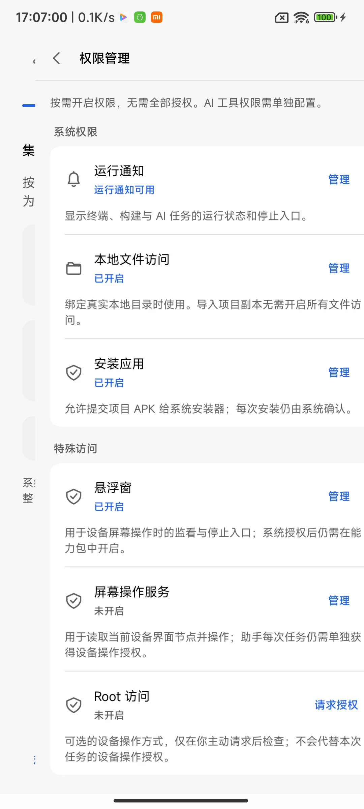 | 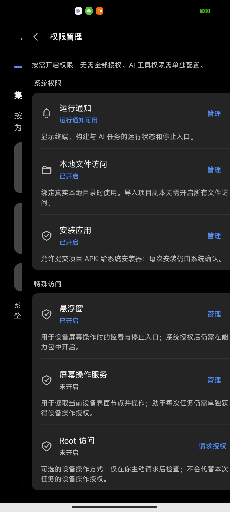 |
| 引导返回上一步 | 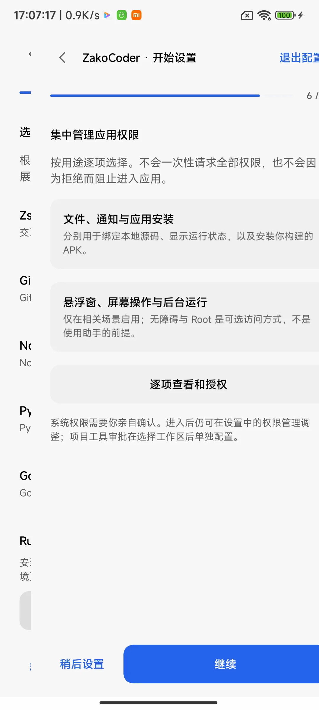 | 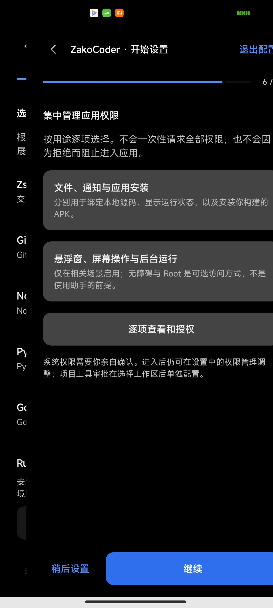 |
| 重新进入引导后返回设置 | 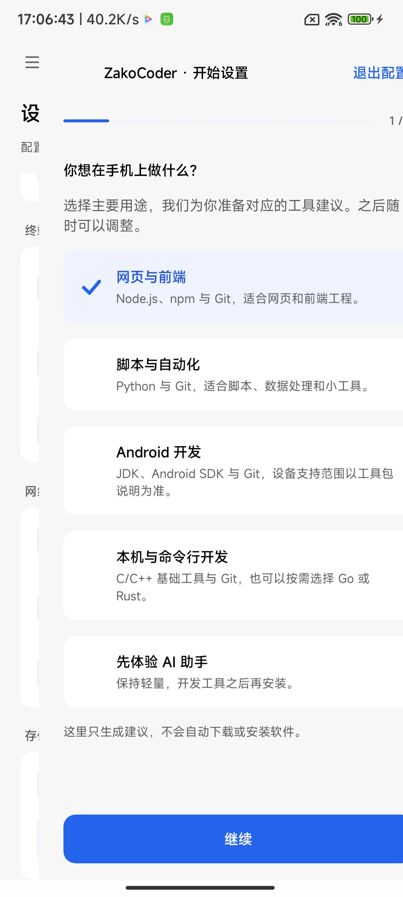 | 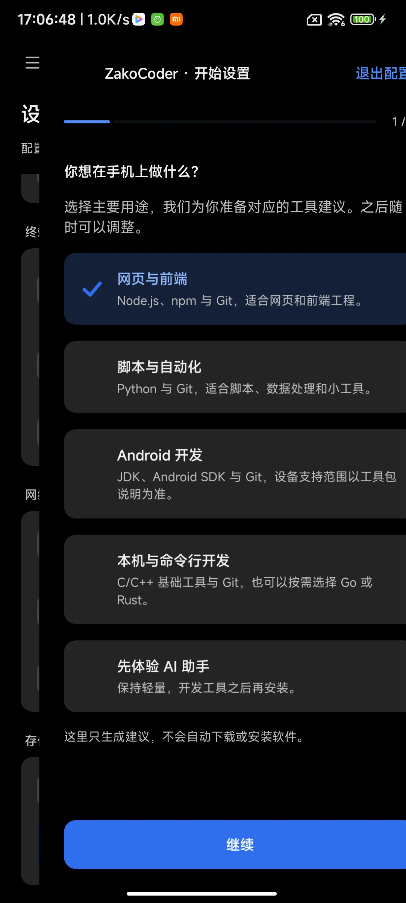 |
| 工作区对话列表（前序阶段） | 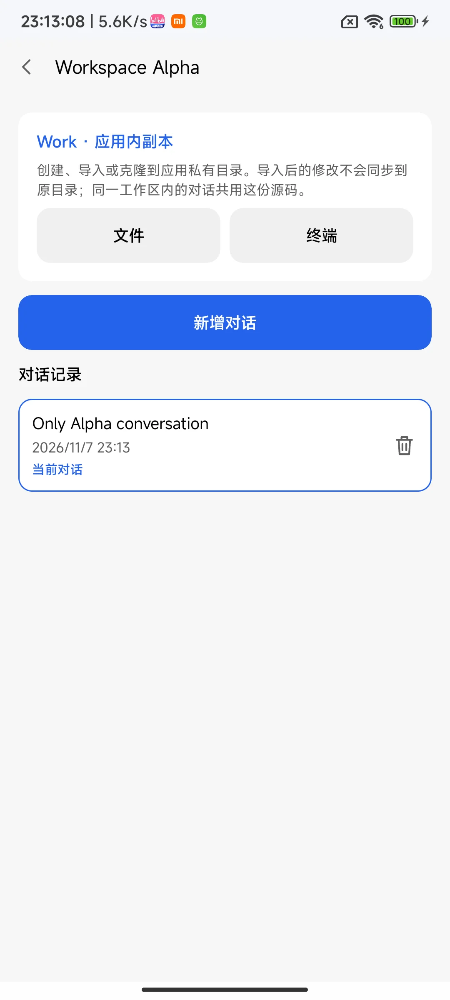 | 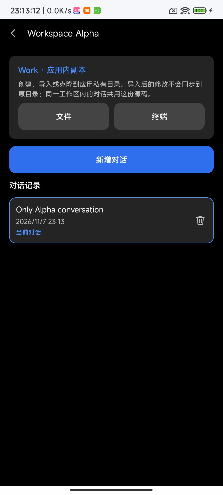 |
| 对话侧栏（前序阶段，底部布局后续已调整） | 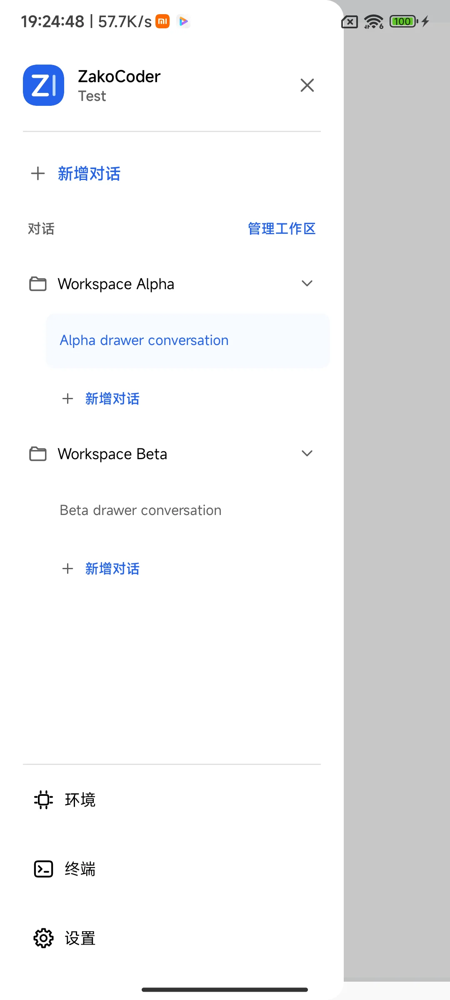 | 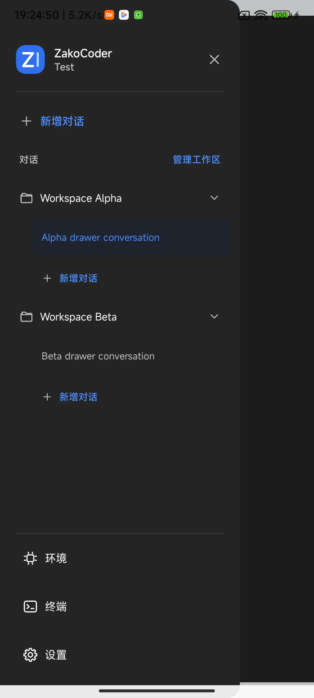 |
| 全局 Skill | 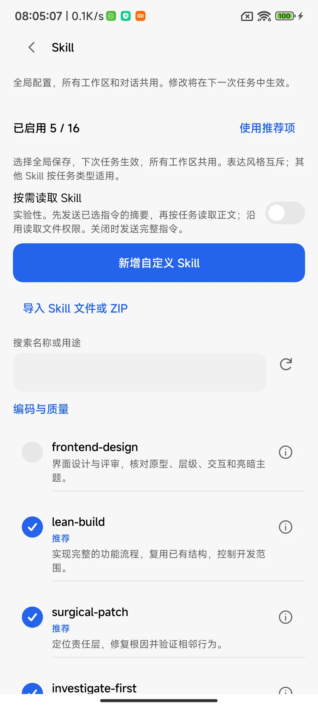 | 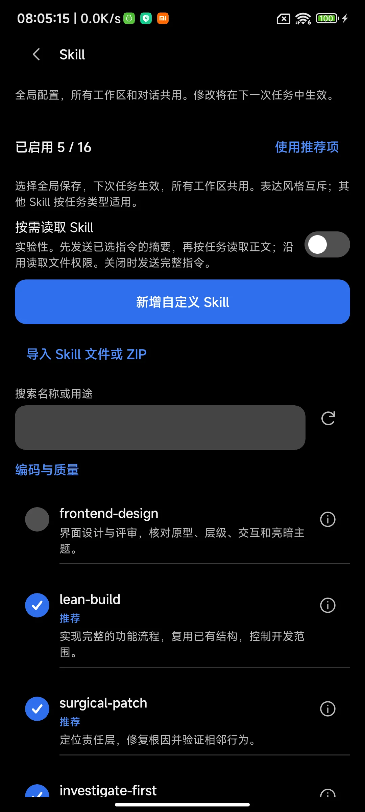 |
| 全局 HTTP MCP 配置 | 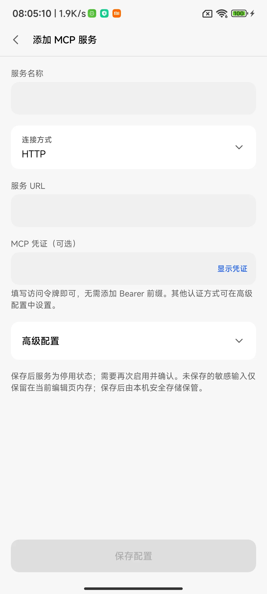 | 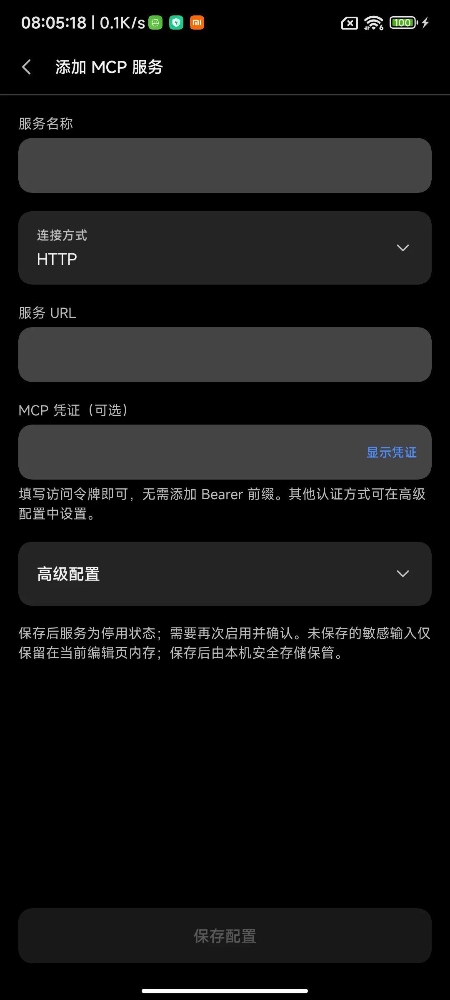 |
| 按任务授权屏幕操作 | 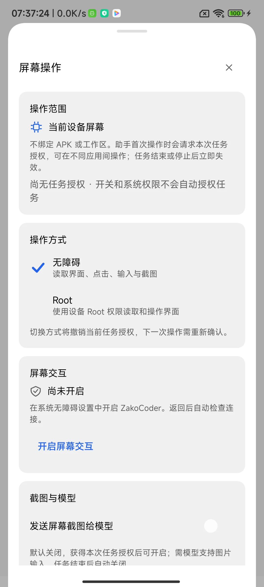 | 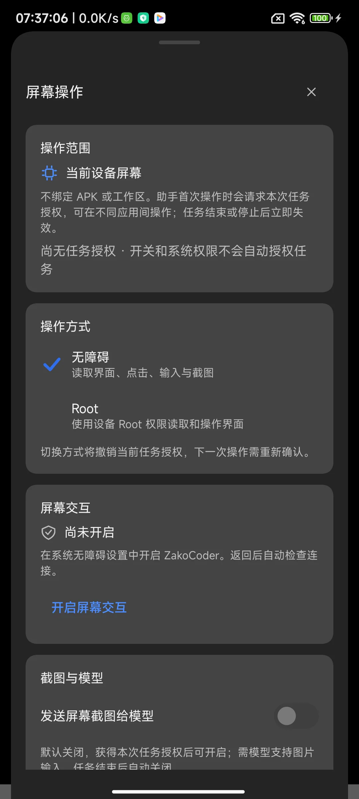 |
| 权限管理（前序阶段） | 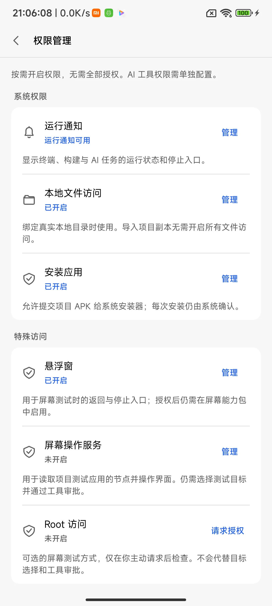 | 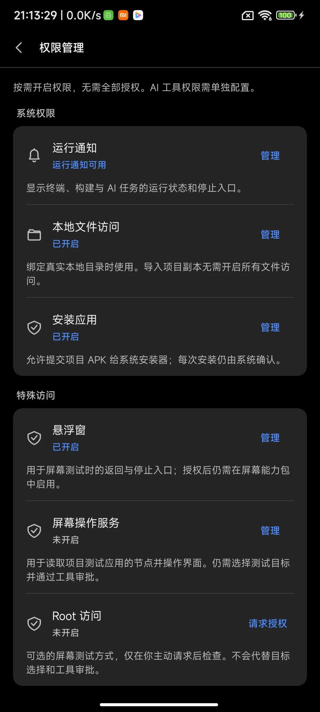 |

## 验证范围

- 本次：Debug 主包与仪器测试包编译通过；真机 `OnboardingNavigationDeviceTest` 3 项通过；仓库检查与差异空白检查通过。
- Action 版本与分发：47 项 Python 定向测试通过；前序完整脚本回归 138 项通过，应用更新定向 JVM 测试通过。
- 前序全局扩展阶段：主包编译和 Lint 通过，28 项定向 JVM 用例、47 项设备用例通过；3 个旧 UI 夹具的控件查找超时仍未通过，未据此宣称全量通过。
- 当前未重跑完整仪器测试集；最终公开 CI 结果以 PR Checks 为准。工作区另有未纳入 PR 的图标修改，曾触发未使用资源 Lint；未修改或删除这些用户文件。
