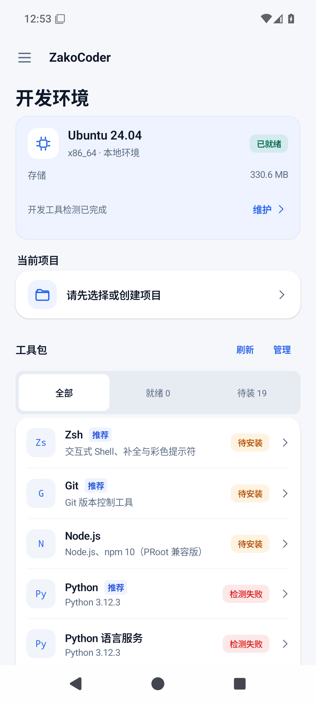
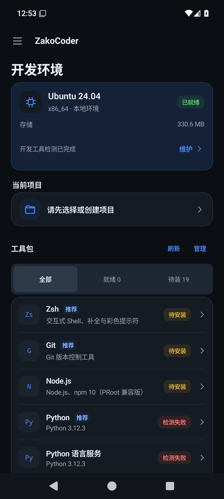
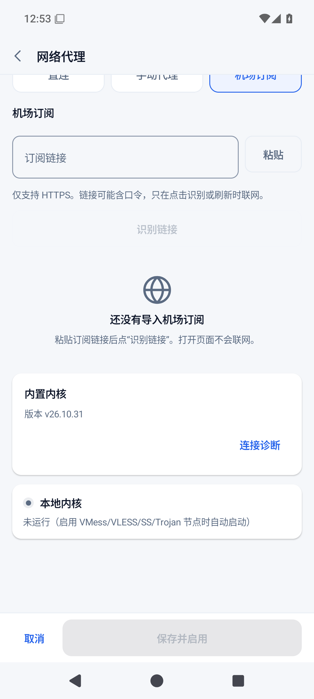
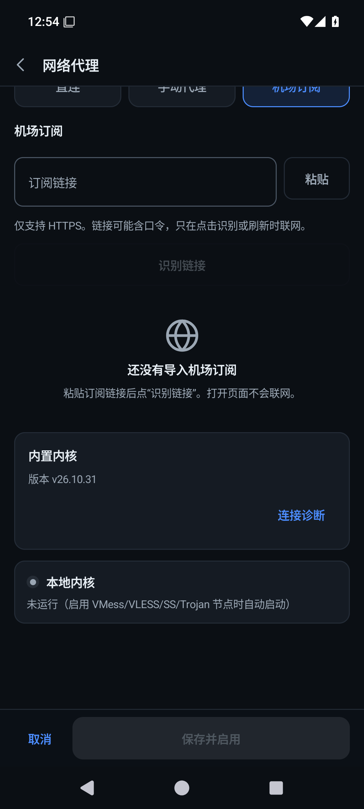

# Lite / Full 分发界面验证

2026-11-06，模拟器采用 1080 × 2400、420 dpi 和默认字号。仅作为模拟器证据，不代表 ARM64 厂商真机验收；未执行 130% 字号测试。

## 完整应用页面

以下为 API 35 x86_64 的实际 R8 Release 包，基于已同步最新主线的实现；没有插入测试页面或伪造环境状态。Ubuntu 来自该 APK 内的固定原包，项目与模型保持空白。系统栏跟随日夜主题。

| 位置 | 日间 | 夜间 |
| --- | --- | --- |
| Full 开发环境就绪 |  |  |
| Full 内核页面 |  |  |

## Full 内置内核组件

| 日间 | 夜间 |
| --- | --- |
|  |  |

来自 API 33 x86_64 隔离测试包 `dev.zakocoder.app.runtimecheck` 的实际 Compose 组件。确认内置版本和诊断入口可见，外置插件的在线安装、本地安装、更新、移除和激活入口均不显示。测试容器未同步系统状态栏／导航栏主题，这两张图只验证组件内容及主题，不作为整页系统栏验收。

## 已执行的分发检查

- Debug 和 R8 Release 均实际构建 Lite / Full × ARM64 / x86_64 四包；验证单 ABI、版本身份、签名、edition 标记和四包 SHA-256 清单。
- Full 对应 ABI 的原始 Ubuntu 归档及内核摘要与固定清单匹配；Lite 不含这两项，不嵌套插件 APK。
- API 33 隔离测试分别验证 Full 内置内核、Lite 外置插件的真实本地认证代理转发，以及替换、停止和日夜组件。
- Full 内置 Ubuntu 验证取消清理、错误代理下的纯本地安装、重试和已有环境保护。
- API 35 的实际 R8 Release：从 Lite 和 Full 分别起步验证项目创建、编辑保存、模型配置、强停恢复与双向覆盖保留。同步主线 Compose / Markdown 依赖升级后，重新构建八包，并复核 Full → Lite → Full 完整链路。
- 集成后的 556 项应用单测、10 项内核单测、120 项脚本测试和 Lint 通过。

ARM64 本轮仅完成构建、包体与同 edition 代码资源一致性检查，未连接 ARM64 真机。x86_64 支持基础 Ubuntu 与终端，不代表 ARM64 专用 Android SDK / NDK / Flutter 工具包已适配。
