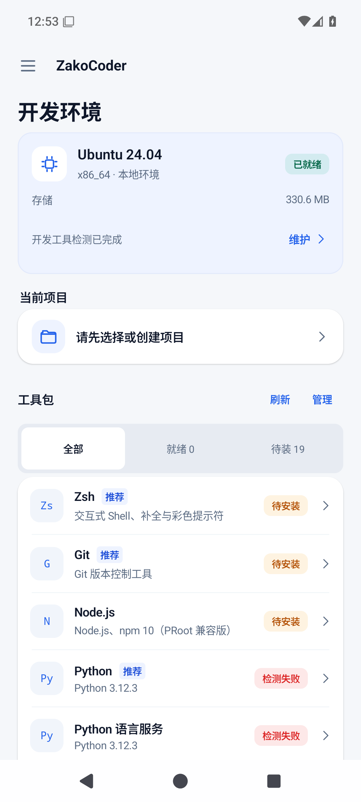
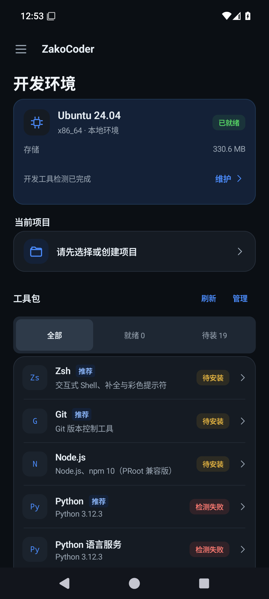

# Lite / Full Ubuntu 历史界面验证

以下保留 Ubuntu 初始化的历史证据，不表示当前版本已完成同项验收。

2026-11-06，模拟器采用 1080 × 2400、420 dpi 和默认字号。仅作为模拟器证据，不代表 ARM64 厂商真机验收；未执行 130% 字号测试。

## 完整应用页面

以下为 API 35 x86_64 的实际 R8 Release 包，基于已同步最新主线的实现；没有插入测试页面或伪造环境状态。Ubuntu 来自该 APK 内的固定原包，项目与模型保持空白。系统栏跟随日夜主题。

| 位置 | 日间 | 夜间 |
| --- | --- | --- |
| Full 开发环境就绪 |  |  |

## 已执行的分发检查

- Debug 和 R8 Release 均实际构建 Lite / Full × ARM64 / x86_64 四包；验证单 ABI、版本身份、签名、edition 标记和四包 SHA-256 清单。
- Full 对应 ABI 的原始 Ubuntu 归档与固定清单匹配；Lite 不含该归档。
- Full 内置 Ubuntu 验证取消清理、错误代理下的纯本地安装、重试和已有环境保护。
- API 35 的实际 R8 Release：从 Lite 和 Full 分别起步验证项目创建、编辑保存、模型配置、强停恢复与双向覆盖保留。同步主线 Compose / Markdown 依赖升级后，重新构建八包，并复核 Full → Lite → Full 完整链路。

ARM64 本轮仅完成构建、包体与同 edition 代码资源一致性检查，未连接 ARM64 真机。x86_64 支持基础 Ubuntu 与终端，不代表 ARM64 专用 Android SDK / NDK / Flutter 工具包已适配。
