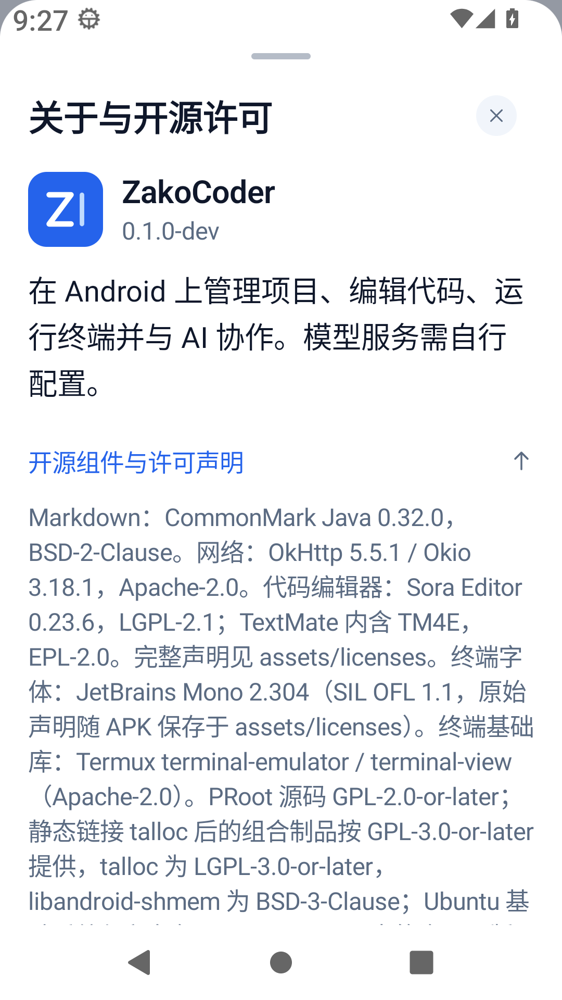
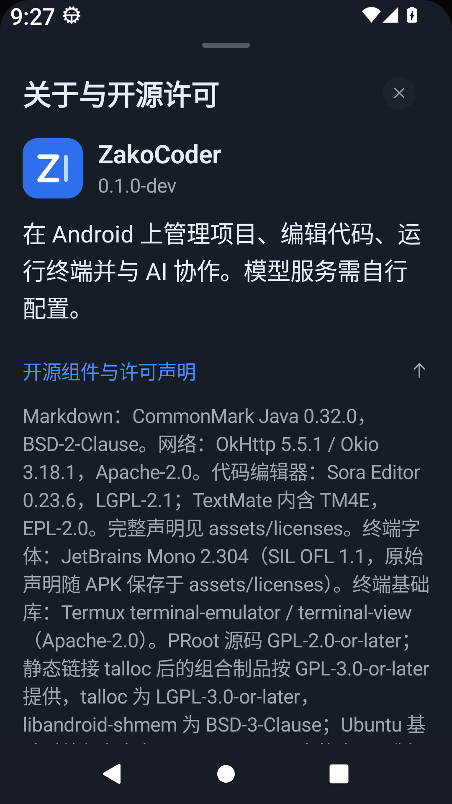

# CommonMark 0.32.0 组件声明截图

- 日期：2026-11-06。
- 页面：设置 → 关于与开源许可 → 展开“开源组件与许可声明”。本次可见变化为 CommonMark Java 的版本号更新为 0.32.0。
- 设备：Android 13 / API 33，x86_64 模拟器；1080 × 1920，480 dpi，逻辑宽度 360 dp，字体比例 130%。
- 构建：隔离验证包 `dev.zakocoder.app.runtimecheck`，显示的应用版本为 `0.1.0-dev`，不是正式发布版本。
- 测试数据：空白隔离应用，手动打开实际设置页面；没有导入用户项目、模型配置或订阅。
- 实际检查：日间与夜间均确认 CommonMark 0.32.0 声明可读、可滚动，没有文字横向溢出；版本声明不涉及键盘输入，页面未打开键盘。截图包含系统状态栏、导航栏和底部安全区。
- 截图来自本批依赖的组合验证构建。对应产品输入（`app/src/main`、`app/build.gradle.kts`、`build.gradle.kts`、`gradle/libs.versions.toml` 中 Git 跟踪的文件，按路径排序，以“路径 + NUL + 文件字节 + NUL”连接）的 SHA-256：`538cf9ac085c15a00501079360984556b18b69d0038dd8de941097cd8bce6e93`。已核对此摘要与合并最新主线后的产品输入一致，截图文件及本文不参与摘要。
- 验证方式：本页使用实际模拟器手动导航、UI 文本核对及截图检查。既有 `UserFacingSettingsDeviceTest` 在导航等待处失败，未计为通过；该自动化限制不应描述为完整 UI 测试通过。

| 日间 | 夜间 |
| --- | --- |
|  |  |
